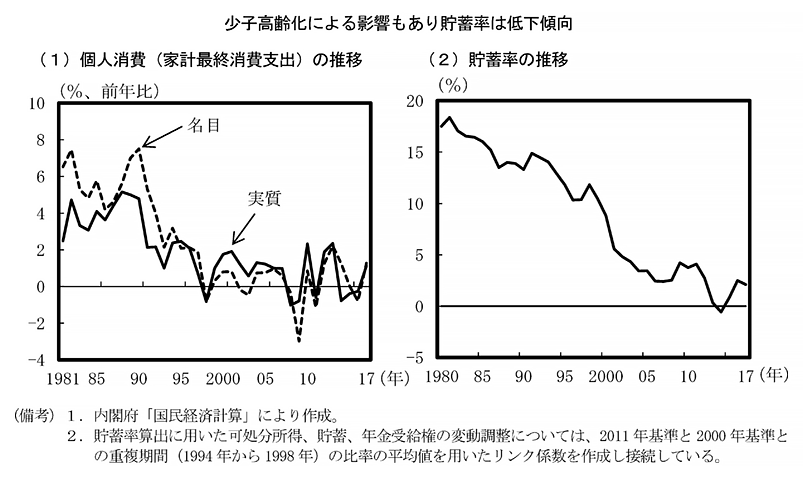
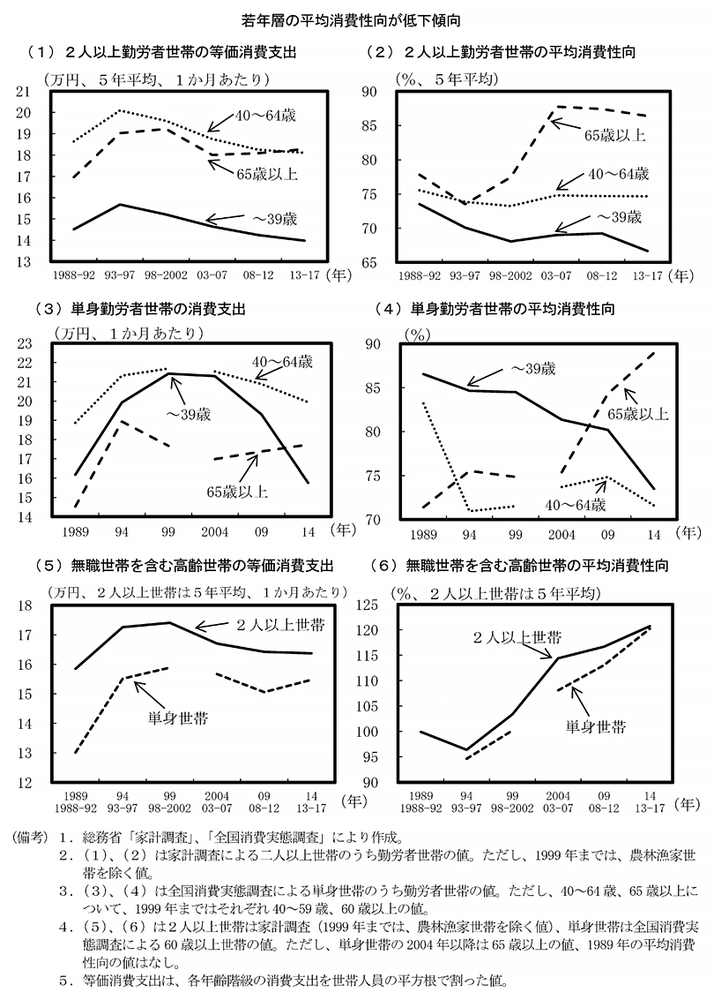

# アドバンスセミナーIIB 経済シリーズ 4<!-- omit in toc -->
仕事と生活に活かせる 10 の経済学思考(後半)

## 「会社に入る前に知っておきたいこれだけ経済学」
この本を参考に数回やっていこうと思います。

[会社に入る前に知っておきたいこれだけ経済学](https://www.amazon.co.jp/%E4%BC%9A%E7%A4%BE%E3%81%AB%E5%85%A5%E3%82%8B%E5%89%8D%E3%81%AB%E7%9F%A5%E3%81%A3%E3%81%A6%E3%81%8A%E3%81%8D%E3%81%9F%E3%81%84-%E3%81%93%E3%82%8C%E3%81%A0%E3%81%91%E7%B5%8C%E6%B8%88%E5%AD%A6-%E5%9D%AA%E4%BA%95-%E8%B3%A2%E4%B8%80/dp/4478101337)

## この本の章立て
1. ビジネスの大原則を理解できる 10 の経済理論
2. 仕事と生活に活かせる 10 の経済学思考
3. 世の中を知るモノサシとなる 10 の経済知識
4. 知らないとヤバい! 現代経済史 60 年の 10 大経済ニュース

となっています。今日は、第2章の後半5つについてやろうと思います。

なるべくわかりやすくなるように、抜粋や youtube 利用していきます。

## 序章・第1章のまとめ
- 経済学の目的は「人の行動」「国の行動」の研究
- 家計・企業・政府という 3 つの主体がある
- 市場は財・サービスを交換する場で、交換に貨幣が利用される。
- 価格は完全競争市場であれば市場メカニズムで決定されるが、ほとんどそんな例はない。
- 望ましくない状態で均衡する場合があり、それはゲーム理論の囚人のジレンマなどにより説明され、ナッシュ均衡と呼ぶ
- 通常のビジネスでは生産要素 (土地・資本・労働) を投入してもなかなか収益が上がらないが、IT業界では逆に収穫逓増のビジネスが増えている。

## 簡単に、まとめると
価格は人間が合理的な行動をとらないため、単純には決まらない。

## 第二章前半のまとめ
仕事と生活に活かせる経済学思考
- インセンティブを与えることによって同じ目的に向かって動けるようになることがある
- 意思判断をするときに考えても意味がないことは排除して考えよう (サンクコスト)
- 一人でやる時よりも、協調して”比較優位”のことを分担した方が効果的なことがある
- 人は限定的にしか合理的に判断しない
- 世界中に資本主義の国はたくさんあるが、日本はその中でも独特なやり方をとって発展してきたが、最近それが壊れてきている。

# 仕事と生活に活かせる 10 の経済学思考(後半)

## トピック
1. ビジネスで最重要!「消費」の読み方と考え方
2. 経済は「名目」と「実質」に分けて考えよう
3. 社会人なら知っておきたい「資産価格」の考え方
4. 「規制緩和」に目をこらして新市場をつくれ
5. 「イノベーション」の本当の意味

今回も、別に順番に学ぶ必要があるトピックではなく、考え方にこんなことがあるよ！という内容です。

ただし、それらの考え方は仕事や生活に活きるかもしれません。
常識とは違う考え方が出てくるかもしれません。

最後に一つ選んでレポート提出してもらいます。

## 1. ビジネスで最重要!「消費」の読み方と考え方
### 所得・消費・貯蓄
稼いだ金は使うか貯めるしかないので、
> 所得=消費+貯蓄

は問題ないよね。つまり、消費と貯蓄はどちらかが増えればどちらかが減る、という関係にある

### 日本人の貯蓄率?
「日本の貯蓄率は世界でも異常なほど高いといわれている」が、どうやら昔のことで実態と異なるらしい。

### 貯蓄ゼロ世帯

金融広報中央委員会「家計の金融行動に関する世論調査」（令和5年）より(株)Money&You作成

- [20代～60代で1,000万円貯めている人・貯蓄ゼロの人の割合は？](https://invalance.co.jp/invest-066/)

### 貯蓄が減少する理由
- 東日本大震災の影響
- 不況の影響
- 少子高齢化の影響

高齢化が進むと貯蓄を取り崩して消費する人が増える。そのため、貯蓄率は減少する。

勤労者世帯の平均消費性向 (所得における消費の割合) は本(発売日2017/2/24)によるとここ数年かわっていないとあるが...

### 下がってる...
<!--

-->

 [第2章　賃金の持続的な上昇と個人消費の力強い回復に向けて（第1節）](https://www5.cao.go.jp/keizai3/2024/0212nk/n24_2_1.html)

- 第2－1－1図 二人以上勤労者世帯の平均消費性向の長期的な動向
- 第2－1－2図 平均消費性向の日米比較

### ライフサイクル仮説
消費支出は人生のなかでどのように変化するのか。こうした消費と所得の関係を個人の人生を通して考え、モデル化した考え方を**ライフサイクル仮説**という。

- 20代:消費しながらも結婚を考え、いくらか貯蓄に回す
- 30代:結婚、年々所得は増え、消費も増える。住宅を購入し、貯蓄をマイナスにして借金する
- 40-50代:子供が成長していくと学資に備えて貯蓄するが所得も増え ている。やがて子供は独立
- 60代: 退職すると所得は激減し、貯蓄を消費に回すために貯蓄率はマイナスとなる

<!--
[What is The Life Cycle Hypothesis?(1:30)](https://www.youtube.com/watch?v=M7JBB7mCbK4)
-->

### 現在の所得と消費
このような将来の人生 (ライフサイクル) を予測しながら現在の消費にお金をつかう。つまり、現在の所得だけで消費が決まるわけではない。

### フリードマンの恒常所得仮説
- 恒常所得：将来まで得られ続けると予測可能な所得
- 変動所得：一時的な所得の増加

消費は現在の所得ではなく、恒常所得によって決定されることに気付く。

短期的に変動所得が増えても、長期的な恒常所得は変わらないので消費の水準も変わらない。

これをフリードマンの**恒常所得仮説**という。

恒常所得が将来も増えていくと予測できる経済環境がないと、消費は増えない。

本に書いていない、 **相対所得仮説** も含めて動画でみてみましょう。
- [（令和9年版）【講義動画｜診断士・経済学・経済政策・マクロ経済学・009】消費の3大仮説(5:50-12:32  x1.25)](https://youtube.com/watch?v=EpgCAZI76BI&t=350)

## 2. 経済は「名目」と「実質」に分けて考えよう
### 「名目」と「実質」
経済成長率、賃金上昇率、利子率 ( 金利) など、さまざまな数値には名目と実質がある
- 名目:現れた数値そのまんま(見かけ上の数値)
- 実質:名目から物価上昇分を差し引いた数値のこと

> 実質 = 名目 - 物価上昇分

- [経済学でよく聞く「名目」と「実質」の違いってなに？(5分で学ぶ経済学)(5:18)](https://www.youtube.com/watch?v=pVwHvYZGLks)

### 実質金利の例
- 銀行で 1000 円預金して、金利が 10%なら 1 年後 1100 円
- でも、一年後に物価が 5%上がってたら、1000 円で変えたものは1050 円になっている。
- 1100/1050=1.078 なので、実質 7.8%の利息がついたことになる。

もっと極端にいうと
- 銀行で 1000 円預金して、金利が 10%なら 1 年後 1100 円
- でも、一年後に物価が 2 倍に上がってたら、1000 円で買えたものは 2000 円になっている。

預けても損してるよね。

### 物価が下がっていた場合には?
もう一つ極端な例
- 銀行で 1000 円預金して、金利が 10%なら 1 年後 1100 円
- その一年で物価が半分に下がってたら 500 円

ラッキー!!!... 預けた人には本当だね... でも...

### 金を借りてて物価が下がった場合には?
物価が半分に下がったとして
- 銀行から 1000 円借りていて、金利が 10%なら 1 年後 1100 円返さない
と...
- その一年で物価が半分に下がってたら、稼げる金額も半分になってる(と仮定)
- 返す金額は価値として倍以上になってしまう 

借りた人には地獄が待っている...

### インフレ・デフレ
- インフレ 物価上昇し続ける状態
- デフレ 物価下落し続ける状態
 
### ゼロ金利・マイナス金利政策
金利は日本銀行が「政策金利」を決定して、それが金融機関の預金金利・貸出金利に影響を与えます。

そのため、日銀は実質金利を下げて世の中に出回るお金を増やす目的で「ゼロ金利・マイナス金利」という決定を行っていました。

- [②①ゼロ金利(2:24)](https://www.youtube.com/watch?v=Exfhn6hVhXQ)
- [【解説】日米の金利差が開くと、なぜ「円安」になるのか「投資家は金利差を利用して儲ける」（2022年10月17日）(1:24)](https://www.youtube.com/watch?v=24OLJuVJ50k)

### 名目賃金・実質賃金
賃金においても同様のことが言える。

インフレ率 (物価上昇率) を 2%に設定した場合、賃金が 2%以上上昇しなければ、実質賃金は下がることになってしまい、消費が冷え込んでしまう。

<!--
[経済学でよく聞く「名目」と「実質」の違いってなに？(5分で学ぶ経済学)](https://www.youtube.com/watch?v=pVwHvYZGLks)

[実質賃金と名目賃金](https://www.youtube.com/watch?v=NUax3mbbt70)
-->

- [【時事をたのしもう】名目賃金と実質賃金とは？(5:34 x1.25)](https://www.youtube.com/watch?v=f99IUUiYvlw)

### 現在の状況
- **名目賃金（現金給与総額）:** 2026年春闘では連合集計で平均5.01％（中小は4.69％）の大幅な賃上げが実現し、月次データでも3％前後の高い伸びが続いています。
- **実質賃金（物価変動を考慮した購買力）:** 長らくマイナス圏が続いていましたが、名目賃金の上昇に加えて物価上昇率の伸びが鈍化したことから、2026年に入りプラス圏で推移しています。7月分は前年比＋2.4％の増加となりました。
- **今後の懸念点:** 秋以降のエネルギー・食品価格の上昇や中東情勢の影響による物価動向次第で、再び下振れするリスクが指摘されています。

[実質賃金・名目賃金](https://www.keizai-ondokei.net/real-wages/)
名目・実質賃金 前年同月比（%）
<!--
- 物価は2024年9月、前年同月比2.5%の上昇
- 最低賃金(東京)は1,113円から11,63円(2024/10/1より)で、50円引き上げ(引上げ率約4.5%)！！

ちょっとグラフを作ってみたのですが、最近では1番の伸びとなっています。
-->
<!--
- 少し古いけど、2022年の平均世帯所得は？
  [2022年の平均世帯所得は524万円で前年から...](https://www.jil.go.jp/kokunai/blt/backnumber/2024/08_09/kokunai_02.html)

最低賃金は物価と比較すると実質上がってるけど、平均世帯所得は上がってないですね。(そもそもだけど...)

推移を見てみると、
- [「残念な統計」の毎月勤労統計：8月結果](https://www.dlri.co.jp/report/macro/282789.html)
-->

### Ｇ７各国の賃金（名目・実質）の推移
- [Ｇ７各国の賃金（名目・実質）の推移](https://www.mhlw.go.jp/stf/wp/hakusyo/roudou/21/backdata/column01-03-1.html)

## 3. 社会人なら知っておきたい「資産価格」の考え方
### 資産と財・サービスの価格
- 資産:お金を生む可能性のある財産
- 財・サービス:消費後価値がなくなってしまうもの

資産の定義はややあいまいだが貨幣・株・不動産・美術品・証券・債権・ 特許権など

iPhone はそのうち利用できなくなるので財・サービスだ。

### 資産価格とリスクの関係
資産はお金を生むが、リスクもあるし、名目ではなく実質でも考えないといけない...

難しいので、このくらいで(数式多すぎなので)...

ドンピシャじゃないけど...
- [投資におけるリスクとリターン(2:32)](https://www.youtube.com/watch?v=WLRbjxhzgWo)

## 4. 「規制緩和」に目をこらして新市場をつくれ
### 新自由主義
政府による市場または個人への介入を最小限とする思想で 1980 年前後 にイギリスやアメリカで起きた考え方です。
#### 小さな政府
政府の介入を最小限にすれば企業は活発に競争を行い消費 者の選択肢も広がる。国の機能が少ないため国民の負担を 軽減できる一方、保証が少ない分格差や貧困が生まれやすくなる。
#### 大きな政府
政府が社会や市場に介入し、貧困層に対して「社会保障」と いう網をしっかりとつくっておけば、極端な貧富の差や貧困 はうまれづらくなる。一方政府が市場に制限をかけること になり経済は停滞しやすく、国民の負担も大きくなる。

### 規制緩和によるビジネスチャンス
日本では 1980 から JR,NTT,JT など民営化を勧めたり、金融自由化が行われたり、した結果
- 駅ビルのショッピングモール化
- 通信の自由化
- ネット証券会社や個人投資家の増加

など多くのビジネスチャンスを生んだ。

### 規制緩和が進む
規制緩和=自由市場の拡大=市場経済の原則である完全競争市場を目指した。

一方で
- 雇用の自由化による非正規雇用増大
- 危険な金融商品による経済危機 (リーマンショック)

など、問題もある。

### 規制緩和の功罪
- 自由な経済は不安定になるが豊かさを得られる
- 規制だらけの経済では価格は下がらず人々は高い生活を強いられる。しかし経済が崩壊する不安定さは避けられるかもしれない

世界が、そして日本経済がどういう方向へ動いているのか、よく観察するべきだ。

### 残業の規制緩和?
2026年9月1日より、労働基準監督署（労基署）による時間外労働の指導方針が見直されました。

- [【「もっと働きたい？」】街の人の本音は 残業時間「月45時間以内」一律指導を見直しへ(5:22)](https://www.youtube.com/watch?v=ty4EhGy43d4)

## 5. 「イノベーション」の本当の意味
### 技術革新?
イノベーションは技術革新だけではない。ここを間違えると視野が狭くなる。シュンペーターという人は

> 経済成長を起動するのは企業家 (アントレプレナー) による新結合 (ニューコンビネーション)

として次の5つに分類した
- 新しい生産物または生産物の新しい品質の創出と実現
- 新しい生産方法の導入
- 産業の新しい組織の創出
- 新しい販売市場の創出
- 新しい買い付け先の開拓

<!--
- [Essential Schumpeter: Creative Destruction](https://www.youtube.com/watch?v=l-soJGRgAAQ)
-->

### OECD の分類
OECD(経済協力開発機構) では、5 つを 4 つに分類した
- プロダクト・イノベーション (製品・サービス)
- プロセス・イノベーション (生産・流通) 
- 組織のイノベーション 
- マーケティング・イノベーション

### Apple の例
2001 年に iPod(iTunes) が発表された。

プロダクト・イノベーションとしてはそれまでも携帯型デジタルオー ィオ端末はあったので (1998 年には mp3 プレーヤー発売) そんなに新しくないが、プロセス・イノベーション (生産・流通) はすごい。

CD をネット上のデリバリーにかえて、持ち歩けるというところが斬新だった。

### リバース・イノベーション
イノベーションは最先端の分野だけではない。

先進国から途上国へ、という常識を逆転 (リバース) させたリバース・イノベーションという言葉もある。

途上国で得たマーケティングの知識と製品開発のノウハウを先進国へ持っていく、というイノベーションは途上国と富裕国の間にある需要のギャップから生まれるとされている。

例えば、レンズ豆を原料としたスナックはインドでしか食べられていなかったが、富裕国に持ってくれば新機軸の食材であったりする。
<!--
- [【アイハーブ】世界五大健康食品の一つレンズ豆のスナック！美味しくてやみつきになる～](https://yukarchive.com/lentil-snacks/)
-->

- [ライト&エアリーレンズ豆チップス](https://www.fashionsnap.com/article/ihearb-appetizer-list/)

### イノベーション
このように様々なスタイルがあるので、技術革新だけでなく様々な視点で物事を観察すれば新しいビジネスを創出できる。

### イノベーターに必要な 5 つの発見力
1. 関連づける力 
2. 質問力
3. 観察力
4. 実験力
5. 人脈力

これらの能力は天賦の際ではなく、学ぶことで獲得できる、とされている。

### 動画
- [ヨーゼフ・シュンペーターのイノベーションの基礎②(10:00 x1.5)](https://www.youtube.com/watch?v=IWhnmmV4zmQ)
<!-- 2024
### ちょっと本から離れて、円安の話
昨日、1ドル151円を超えましたね。

- [ドル/円 151円台へ。8月1日以来の円安水準](https://media.rakuten-sec.net/articles/-/46804)

> トランプ候補が米大統領選で優勢が伝えられる一方日本では衆院選挙で石破自民党の苦戦が予想されるなかで、FRB利下げ期待後退によるドル高と政治不安定化の懸念による円安が同時進行した。
-->

## 課題
- ライフサイクル仮説と恒常所得仮説
- 名目と実質
- 資産価格の理論
- 規制緩和
- イノベーション

からトピックを一つ以上選び 400 字程度で感想を述べよ。