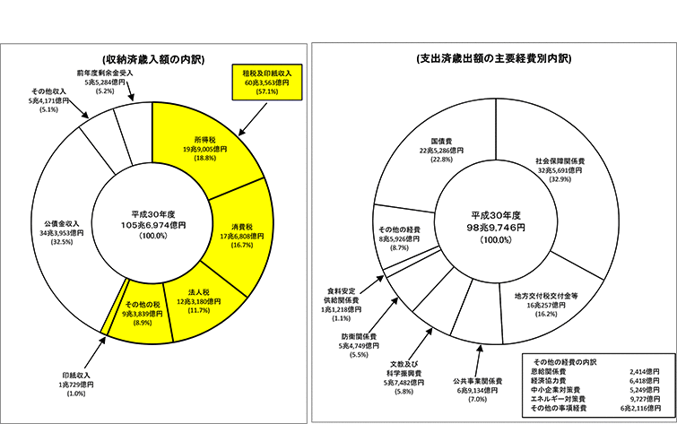
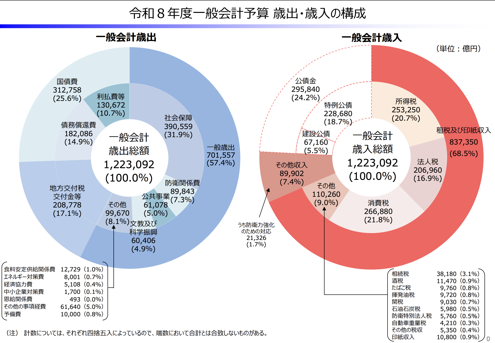
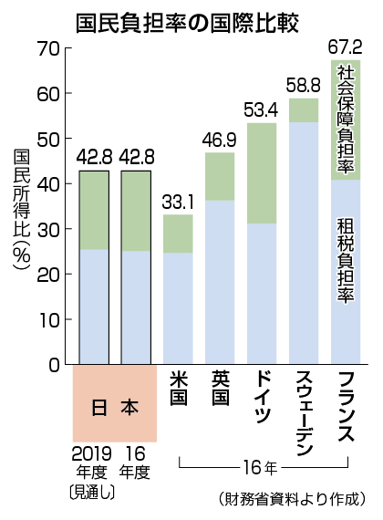
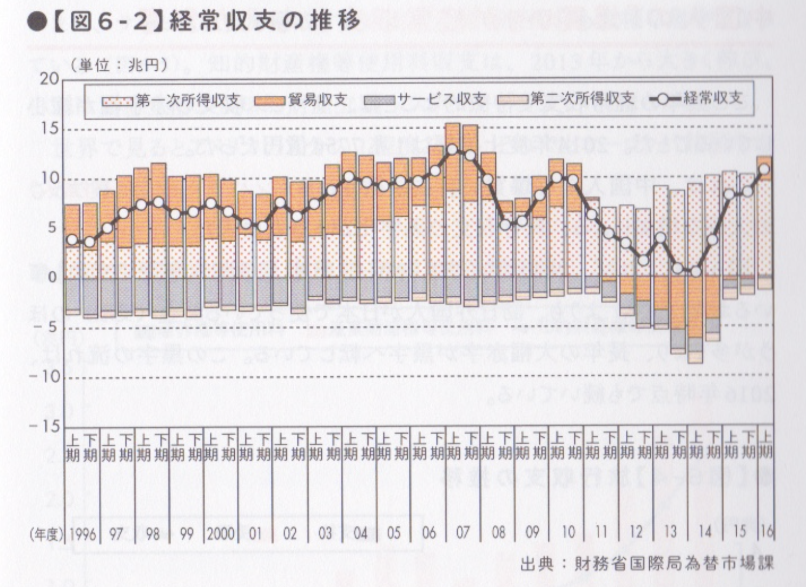
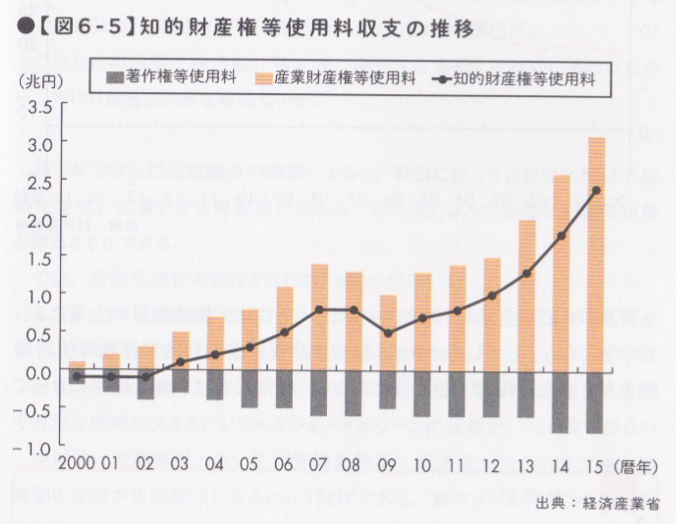

# アドバンスセミナーIIB 経済シリーズ 5<!-- omit in toc -->
世の中を知るモノサシとなる 10 の経済知識(前半)

## 「会社に入る前に知っておきたいこれだけ経済学」
この本を参考に数回やっていこうと思います。

[会社に入る前に知っておきたいこれだけ経済学](https://www.amazon.co.jp/%E4%BC%9A%E7%A4%BE%E3%81%AB%E5%85%A5%E3%82%8B%E5%89%8D%E3%81%AB%E7%9F%A5%E3%81%A3%E3%81%A6%E3%81%8A%E3%81%8D%E3%81%9F%E3%81%84-%E3%81%93%E3%82%8C%E3%81%A0%E3%81%91%E7%B5%8C%E6%B8%88%E5%AD%A6-%E5%9D%AA%E4%BA%95-%E8%B3%A2%E4%B8%80/dp/4478101337)

## この本の章立て
1. ビジネスの大原則を理解できる 10 の経済理論
2. 仕事と生活に活かせる 10 の経済学思考
3. 世の中を知るモノサシとなる 10 の経済知識
4. 知らないとヤバい! 現代経済史 60 年の 10 大経済ニュース

となっています。今日は、第3章の前半についてやろうと思います。

なるべくわかりやすくなるように、抜粋や youtube 利用していきます。

2017年から10年近く経っているので、かなり経済状況変わっていて資料のアップデート大変でした。

## 序章・第1章のまとめ
- 経済学の目的は「人の行動」「国の行動」の研究
- 家計・企業・政府という 3 つの主体がある
- 市場は財・サービスを交換する場で、交換に貨幣が利用される。
- 価格は完全競争市場であれば市場メカニズムで決定されるが、ほとんどそんな例はない。
- 望ましくない状態で均衡する場合があり、それはゲーム理論の囚人のジレンマなどにより説明され、ナッシュ均衡と呼ぶ
- 通常のビジネスでは生産要素 (土地・資本・労働) を投入してもなかなか収益が上がらないが、IT 業界では逆に収穫逓増のビジネスが増えている。

## 簡単に、まとめると
価格は人間が合理的な行動をとらないため、単純には決まらない。

## 第二章前半のまとめ
仕事と生活に活かせる経済学思考
- インセンティブを与えることによって同じ目的に向かって動けるようになることがある
- 意思判断をするときに考えても意味がないことは排除して考えよう (サンクコスト)
- 一人でやる時よりも、協調して”比較優位”のことを分担した方が効果的なことがある
- 人は限定的にしか合理的に判断しない
- 世界中に資本主義の国はたくさんあるが、日本はその中でも独特なやり方をとって発展してきたが、最近それが壊れてきている。

## 第二章後半のまとめ
- 稼いだお金は使うか貯めるなので「所得=消費+貯蓄」生活ステージ (ライフサイクル) で使うお金の金額は変わる
- 様々な指標には実際の金額 (名目) と物価上昇分を差し引いた (実質) とがある
- 将来お金を生む可能性のある (資産) と消費後なくなる (財・サービス) があり、資産はリスクもある
- 規制緩和により世の中には大きな自由が与えられる一方、不安定になり格差が広がる懸念がある
- イノベーションとはたんなる技術革新だけではない。

# 世の中を知るモノサシとなる 10 の経済知識

### この章で扱う内容
章のタイトルが「世の中を知るモノサシ」といっているので、どう世の中の動きをとらえるか、というマクロ経済学的な視点の話が多いです。

自分がどう稼ぐか・消費するか、といった身近ではない考え方ですので難しくなっていきます。

### マクロ経済学
デフレ・インフレという言葉が最近よく使われますが、この辺はこの大きな視点がないと理解するのが難しいです。

でも、なんで自分の稼ぎが低いんだろう、などと思うときに、自分だけではなく、社会の構造によってそうなっていることもある、という意味では非常に大事な考え方となります。

一般的にデフレ化では借金はしない方がよいとされていますが、これもマクロ的な視点がないと理解ができませんね。

- [[月曜の教養] ミクロ経済とマクロ経済の違いを1分で解説！](https://www.youtube.com/shorts/__RhbGZYUBQ)

## トピック
1. 経済ニュース理解のための基本ワード
2. 経済ニュースの基本「GDP」を覚えよう
3. GDP の理論を知ることで経済を多面的につかむ
4. 日本は裕福なのか貧乏なのか
5. なぜ 21 世紀の日本では投資が増えないのか
6. ニュースでよく聞く「経常収支」ってなんだろう
7. 借金大国日本は潰れてしまうのか
8. マネーを増やし続ける日本銀行の論理
9. 日本はこれからもっと豊かになれるのか
10. 株・為替・債権の価格と金利の働き方

今日は前半+アルファの6までやってみましょう。

## 1. 経済ニュース理解のための基本ワード
まずは、「基本ワード」として、そういう単語がある、というのを認識しましょう。

### 歳入・歳出
個人の家計で収入と支出があるように、政府の収入・支出をそれぞれ
- 歳入
- 歳出

といいます。

### <!--平成30年度 一般会計歳入・歳出決算の概要(円グラフ)-->
<!--

-->

https://www.mof.go.jp/tax_policy/summary/condition/002.pdf

### 歳入と歳出の金額
入るお金と出ていくお金だいたい一緒になっているけど、本当? 

国債費・公債金収入ってのがあって、これって、国債 (政府の借金) を借りたり貸したりした分が加味されてます。

- 歳入−公債金収入 <!--71-->93兆円
- 歳出−国債費 <!--76-->91兆円

国債の貸し借り分を考慮すると、2 兆円黒字となります。

この国債貸し借り分を引いた金額のことを「プライマリーバランス」と呼びます。

### プライマリーバランス(基礎的財政収支) 推移
これまで、ずっと1993年から赤字でした。先ほどのグラフは予算であり、見込みですので、確定していません。黒字化するんでしょうか？

そして、赤字は悪いことでしょうか？

- [日本の財政収支の推移](https://ecodb.net/country/JP/imf_ggxcnl.html)

### 社会保険
公的な保険全般のことで
- 医療保険
- 年金保険
- 介護保険
- 雇用保険
- 労災保険

で、税と同様に徴収されます。働くようになると、税と社会保険で収入から引かれていきます。

持っていかれるという意味では一緒なので、税金と社会保険を合わせて所得のうちどのくらい負担しているか、ということを「**国民負担率**」といいます。

### 国民負担率の国際比較
<!--

-->

- [国民負担率の国際比較（OECD加盟35ヵ国）](https://www.mof.go.jp/tax_policy/summary/condition/a04.htm#a05)

2023年度では日本は45.7%...ほぼ半分となっています。

### 財政政策・金融政策
財政政策は政府が歳出を増減したり、増税減税を行うことで歳入を変えることで経済に影響を与える政策のことです。

金融政策は日本銀行 (日本の中央銀行) が金利を変えたり、日本銀行券を発行したりして経済に影響を与える政策のことです。

### 私たちの銀行・銀行の銀行
私たちは民間の銀行に口座を作りますが、日本政府と金融機関は日本銀行当座預金の口座を作ります。

両方にアクセスできるのは金融機関ということになります。

### マネタリーベース・マネーストック
日銀がお金を大量に発行しても、利用したい人 (お金を借りたい人) がいないといわゆる自分たちの社会までお金が回ってきません。
区別して
- **マネタリーベース** 日本銀行（日銀）が世の中に直接供給するお金
- **マネーストック** 民間の金融機関が社会に供給している資金量

という違いがあります。

### GDP
きいたことありますね。国内で一定期間に生み出された付加価値の総額で、「国内総生産」と呼びます。

全体的にみると「生産=所得=支出」となるため、みんなの所得の合計ととることもできます。

みんなの総所得が成長していれば、景気がよい、ということになりますね。

### 物価指数
モノの値段の変動を表したもの

### インフレ・デフレ
前にやっていますね。
- **インフレ** 物価が継続して上昇すること。貨幣価値は下がる
- **デフレ** 物価が継続して下落すること。貨幣価値は上がる

### 為替
ドルなど外貨との交換比率を為替レートという。

ドルに対し円の価値が上がったり下がったりすることを円高・円安と呼ぶ。

1 ドル 200 円が 1 ドル 100 円になれば、10 ドルのものは 2000 円で買っていたのが 1000 円 (半額) で買えることになる (円高)。

代わりに、アメリカにとっては、100 円のものは 0.5 ドルで買っていたのに 1 ドルとなり倍になることになる。

### 株
株式会社は株を発行することで資金を得ることができる。株主には配当金が入るほか、上場していれば株価の変動により儲けることも可能となる。

日経平均株価とは一部上々している企業のうち 225 社の株価の平均

東証株価指数 (TOPIX) は東証一部上場全銘柄の浮動株を対象として 1968/1/4 の基準日として算出した指標

### 国債
国 (政府) の借金の証文。政府は国債を発行して現金を獲得して歳出に回す。

... うーん、ここはきちんとやりたいけど後に回そう...

国が発行しているためリスクが少ない(ローリスク・ローリターン)。国債に人気がないと価格は下がり、金利は上がる。人気があれば、価格はあがり、金利は下がる。

### 用語が多かったけど
言葉の意味がわからないと全体が見えなくなるよ。

## 2. 経済ニュースの基本「GDP」を覚えよう
### 計算式
> GDP = 民間消費+民間投資+政府支出+(輸出-輸入)

「輸出-輸入」は貿易黒字で貿易でかせいだ分 (純輸出) になるよ。

具体的には
- 2025年の名目GDPは672.7兆円

推計(IMF予測)では
- 2026年 約4兆3419億ドル(世界4位を維持)
- 2027年 約4兆4676億ドル(世界6位へ後退)

 [そりゃインドにも抜かれるわ…GDP「6位転落」予測の日本に〈決定的に足りないもの〉](https://news.yahoo.co.jp/articles/a9addd2bb3693eaa6d9c8b4f8d6ea3327e19b341)

### GDP と経済成長率
GDP がどのくらい伸びたかを**経済成長率**と言って、名目成長率・実質成長率があるよ。

### なぜ景気の動向に「消費」が重要なのか
> GDP = 民間消費+民間投資+政府支出+純輸出

の割合をみると2025年度は
- 民間消費 52.7%
- 民間投資 23.2%
- 政府支出 24.6%
- 純輸出 -0.5%

くらいの割合になっている。
GDP の 5 割以上が民間消費なので、民間消費が増えなければ景気は良くならない。純輸出が2011年以降赤字なのが気になる。

- [日本の貿易収支の推移](https://ecodb.net/country/JP/tt_mei.html)

### インバウンド
海外から外国人観光客が日本を訪れることを**インバウンド**と呼びます。

この規模は、2025年時点で約9.5兆円であり、GDPの1.5%程度です。

### 景気動向指数
GDP の公表には集計などのため 2 ヶ月かかるが、景気の状況をもっと早 く見たい場合には景気動向指数というものが利用できる。

## 3. GDP の理論を知ることで経済を多面的につかむ
### 付加価値
GDP は 1 年間に新しく生み出された付加価値の合計ということになるわけだが、簡単にいうと
1. 200 円で買ってきたお酒を
2. グラスにいれてバーでお客に 500 円で提供した

とすると、300 円分の生産をしたことになり、それが付加価値ということになる。

### 付加価値 2
1. 1000 円で農家はコーヒー豆を食品会社へ売る
2. 食品会社はインスタントコーヒーに加工して3000円販売
3. 消費者はそれを 3000 円で買った。
とすると、0 から 1000 円、1000 円から 3000 円、と付加価値を農家・食品会社は産んだので、1000+2000 で最終的 3000 円の付加価値が生まれている (最終な販売額と結局同じだね)

### 付加価値が増えないと賃金も増えない
企業は付加価値から土地や生産設備にかかる支払うべき費用を支払い、人件費を支払う。付加価値から支払われる人件費の割合を**労働分配率**という。ざっくり70%くらいと考えて良い(本の執筆時2017)。

- [労働分配率の実態を探る－「国民経済計算」と「法人企業統計」が示す異なる姿](https://www.nli-research.co.jp/report/detail/id=86992?site=nli)
- [労働分配率74.4％・81.5％という現実――2026年版中小企業白書が突きつける「稼ぐ力」改革を社労士の視点で読み解く](https://www.mh5.jp/announce_95563.html)

付加価値が増えなければ、経済成長もしなければ賃金も増えないことになる。賃金が増えなければ消費も増えないので生産も増えない。こういう悪循環が続くと脱出できなくなる。

### なぜ国内総「生産」なのに「消費」が入っているの?
例えば A さんがアプリを作って、100円で B さんに買ってもらったとしよう。
- 所得 Aさんは100円もらったよね
- 支出 Bさんは100円支払ったよね
- 生産 Aさんは時間かけて付加価値をつけて100円の商品を作ったよね

と考えると
> 総生産=総所得=総支出

となる。これを**三面等価の原則**という。

### 生産って...
経済的な観点で見ると

売れてみないといくらの生産をしたかわからないんだよね...
売れなかったら生産したことにならないんだよね...

つまり、

1日10個作れたものを15個作れるように頑張って効率あげたとしても、
売れたのは変わらず10個だとすると、**生産性は変わらない**

### 労働生産性
日本の労働生産性が低い、とか中小企業の労働生産性が低い、という言葉がニュースで出てると思うんだけど、これ、最終的にいくらでいくつ売れてるか、が非常に関係ある言葉だとわかるかな。

よく考えると、個人的にはサボってるという意味で「労働生産性が低い」と使えないよね。

と思うけど、意味わかってないと、働き方の問題かな、とか思っちゃうよね。

## 4. 日本は裕福なのか貧乏なのか
### GDP と豊かさ
国の豊かさは GDP で測れるのか?という問題があるが、現状各国の経済力を比較するには GDP 以外に定量的で客観的なデータはない。

### 日本の GDP ランキング
いくつかみてみよう。
- 世界の名目 GDP 国別ランキング・推移(IMF)
  - https://www.globalnote.jp/post-1409.html
- 世界の1人当たり名目 GDP 国別ランキング・推移(IMF) 
  - https://www.globalnote.jp/post-1339.html
- 世界の実質 GDP 成長率 国別ランキング・推移(IMF)
  - https://www.globalnote.jp/post-12798.html

### 日本の GDP
1980 年代の終わりからほとんど増えなかったのが、数年前から少しは伸びている。

- [日本のGDPの推移](https://ecodb.net/country/JP/imf_gdp.html)

日本の人口は減少するので、GDP 総額はそれほど伸びないだろうが、1 人あたり GDP はまだ伸びる余地がある。

実質 GDP 成長率の低さは....

### 実感以上に広がる日本の所得格差
1 人あたりの GDP ランキングが下がっているということは、三面等価の原則から国民 1 人当たりの所得も下がっていることになる。

1980 年代まで「1 億総中流」と言われていたが、21 世紀の日本人は、格差拡大の中に放り込まれている。

### タックスヘイブンの存在が公正・公平感を破棄
1 人あたりの GDP の上位の国には産油国とタックス・ヘイブンが上がってきている。

つまり、資源の恩恵 (カタール・ノルウェー) だったり、金融大国 (ルクセンブルグ・スイス) という国が上がっていることになる。

本国からの課税を逃れるために、税率をものすごく低くし、そのマネーを自由に運用させて儲けているのがタックス・ヘイブンだが、公正さがなく、資本主義市場経済は崩壊してしまうだろう、と本の筆者は述べている。

## 5. なぜ 21 世紀の日本では投資が増えないのか
### 金利が下がると投資が増える理由
金利が下がれば、投資しても利益を生むことができる、と考えれば投資は増えていくはずだ。

### ゼロ金利の日本で投資が増えないのはどうしてか
日本では人々の欲望 (効用) を刺激する商品がなく、需要が増えないことも一因だ。

21 世紀の大ヒット商品は iPod,iPhone などで輸入品が多く、日本企業は投資を激増したわけではない。

### 現在はゼロ金利政策は終了
2024年3月19日にに日本銀行がマイナス金利政策とともに事実上のゼロ金利政策を終了しました。

現在は海外と日本の金利の差がまだあるため、長期的な資産形成を目的とするなら「海外（主に米国や全世界）への投資」が基本となっている。

## 6. ニュースでよく聞く「経常収支」ってなんだろう
### 経常収支
> GDP = 民間消費+民間投資+政府支出+(輸出-輸入) 

の、**輸出-輸入**のことを経常収支・純輸出と呼ぶ。国の国際収支を表す基準の一つ。

### 難しいのでさらっと
- 貿易収支: いわゆる有形の輸出入の貿易差額
- サービス収支: サービス取引の収支(運賃・旅行・保険料・知的財産権等使用料など)
- 第一次所得収支: 海外への投資で得られる収益
- 第二次所得収支: 海外への援助など

### 日本の経常収支の現状
なんとなく日本は貿易で富を蓄積してきた国だから、貿易収支が大きいのだろうと思ってしまうが、リーマンショックの 2008 年あたりから日本の貿易収支はゼロか赤字の期間が多くなっている。

### 日本の経常収支の現状

### 中国人の「爆買い」が経常収支に与えた影響
いわゆるインバウンド (訪日外国人) が日本にきてお金を使うことにより、サービス収支が黒字化している。

もちろん、コロナ時には吹っ飛んでいますが、コロナも落ち着いてきてますね。顕著なのはホテル代かな。

### 知的財産権等使用料
海外で車を生産した場合、現地生産台数に応じて知的財産権使用料が発生する。

これが最近伸びてる模様。つまり生産拠点を移したことによる。

### 知的財産権等使用料の推移

- [使用料収支から見る日本の知的財産権の実力](使用料収支から見る日本の知的財産権の実力)

### デジタル関連収支
- 25年のデジタル赤字は▲6.7兆円と、前年から僅かに縮小した。
- コンテンツ輸出の拡大や円高方向への一時的調整を受け、デジタル赤字の拡大傾向に歯止めがかかったものの、大幅赤字の構図は不変。
- 日本には、デジタル化やAI利活用の拡大を通じて企業の生産性を高めることが求められる。

[大幅なデジタル赤字継続、AI活用拡大による生産性向上が急務](https://www.mri.co.jp/knowledge/insight/dep/2026/i5inlu000003ar3n-att/dep20260209.pdf)

## 今日はここまで
用語が多かったので整理して理解してくれると嬉しいです。
来週は続きの

7. 借金大国日本は潰れてしまうのか
8. マネーを増やし続ける日本銀行の論理
9. 日本はこれからもっと豊かになれるのか
10. 株・為替・債権の価格と金利の働き方

## 課題
- 基本ワード(歳入・歳出, 社会保険, 財政政策・金融政策, GDP, 物価指数, インフレ・デフレ, 為替, 株, 国債)
- GDP, 経済成長率
- 付加価値と三面等価
- GDP国際比較
- ゼロ金利の日本で投資が増えないのはどうしてか
- 経常収支

からトピックを一つ以上選び 400 字程度で感想を述べよ。

