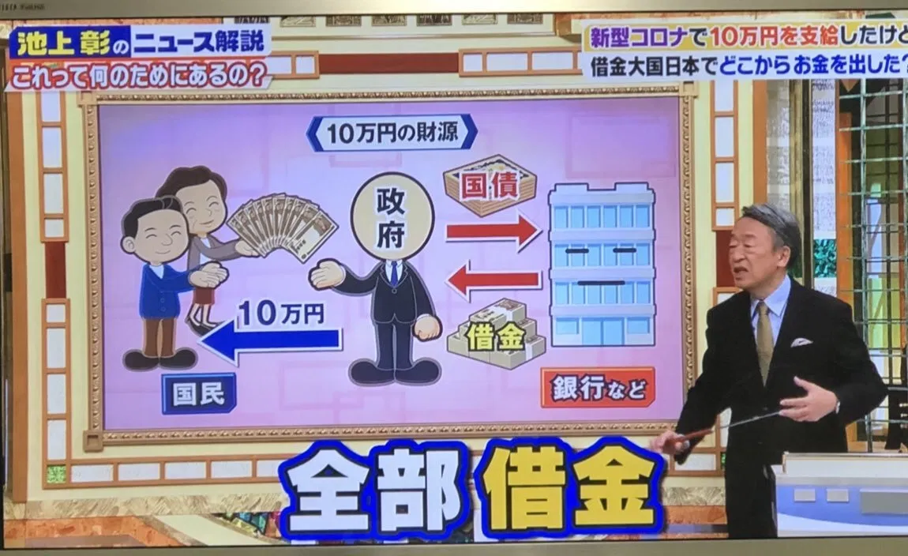
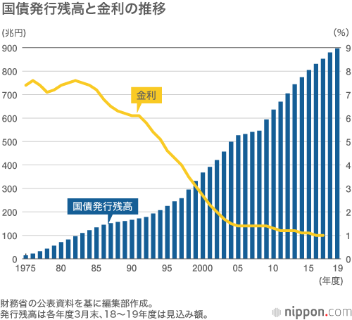
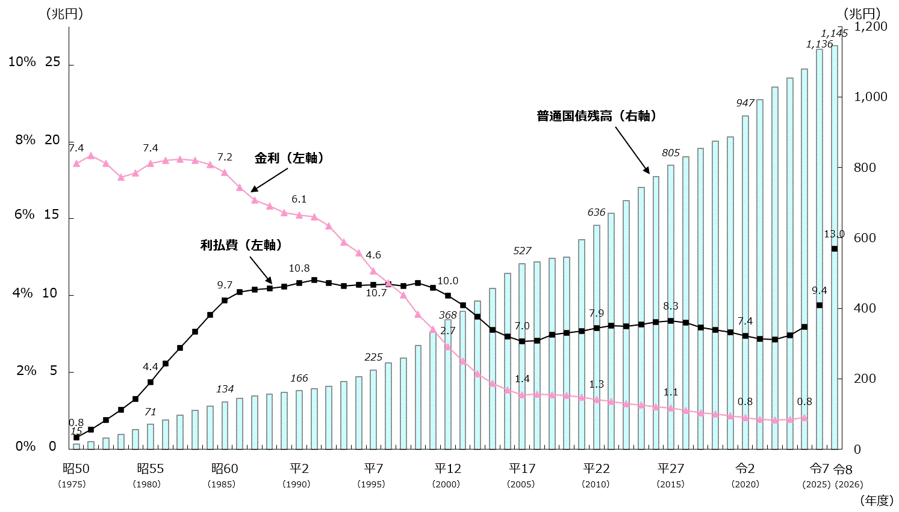
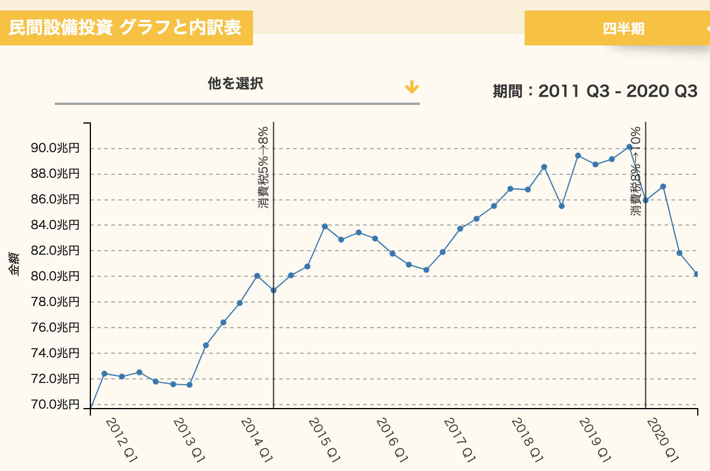
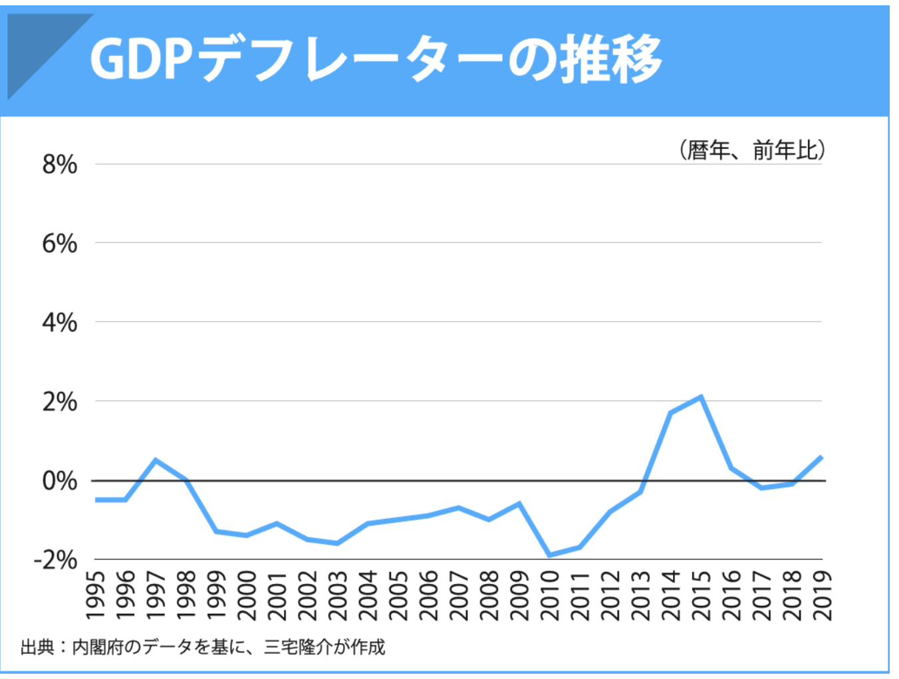
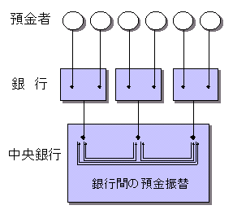
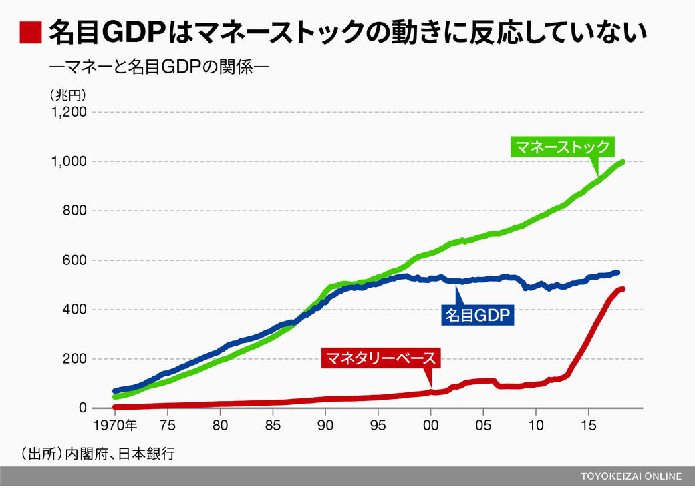
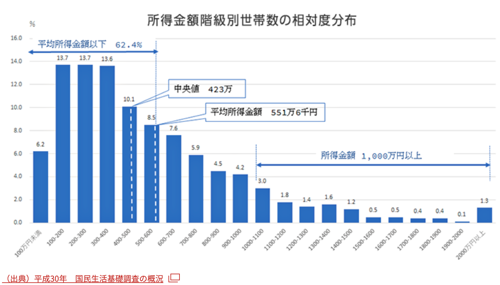

# アドバンスセミナーIIB 経済シリーズ 6<!-- omit in toc -->
世の中を知るモノサシとなる 10 の経済知識(後半)

## 「会社に入る前に知っておきたいこれだけ経済学」
この本を参考に数回やっていこうと思います。

[会社に入る前に知っておきたいこれだけ経済学](https://www.amazon.co.jp/%E4%BC%9A%E7%A4%BE%E3%81%AB%E5%85%A5%E3%82%8B%E5%89%8D%E3%81%AB%E7%9F%A5%E3%81%A3%E3%81%A6%E3%81%8A%E3%81%8D%E3%81%9F%E3%81%84-%E3%81%93%E3%82%8C%E3%81%A0%E3%81%91%E7%B5%8C%E6%B8%88%E5%AD%A6-%E5%9D%AA%E4%BA%95-%E8%B3%A2%E4%B8%80/dp/4478101337)

## この本の章立て
1. ビジネスの大原則を理解できる 10 の経済理論
2. 仕事と生活に活かせる 10 の経済学思考
3. 世の中を知るモノサシとなる 10 の経済知識
4. 知らないとヤバい! 現代経済史 60 年の 10 大経済ニュース

となっています。今日は、第3章の後半についてやろうと思います。

なるべくわかりやすくなるように、抜粋や youtube 利用していきます。

2017年から10年近く経っているので、かなり経済状況変わっていて資料のアップデート大変でした。

## 序章・第1章のまとめ
- 経済学の目的は「人の行動」「国の行動」の研究
- 家計・企業・政府という 3 つの主体がある
- 市場は財・サービスを交換する場で、交換に貨幣が利用される。
- 価格は完全競争市場であれば市場メカニズムで決定されるが、ほとんどそんな例はない。
- 望ましくない状態で均衡する場合があり、それはゲーム理論の囚人のジレンマなどにより説明され、ナッシュ均衡と呼ぶ
- 通常のビジネスでは生産要素 (土地・資本・労働) を投入してもなかなか収益が上がらないが、IT 業界では逆に収穫逓増のビジネスが増えている。

## 簡単に、まとめると
価格は人間が合理的な行動をとらないため、単純には決まらない。

## 第二章前半のまとめ
仕事と生活に活かせる経済学思考
- インセンティブを与えることによって同じ目的に向かって動けるようになることがある
- 意思判断をするときに考えても意味がないことは排除して考えよう (サンクコスト)
- 一人でやる時よりも、協調して”比較優位”のことを分担した方が効果的なことがある
- 人は限定的にしか合理的に判断しない
- 世界中に資本主義の国はたくさんあるが、日本はその中でも独特なやり方をとって発展してきたが、最近それが壊れてきている。

## 第二章後半のまとめ
- 稼いだお金は使うか貯めるなので「所得=消費+貯蓄」生活ステージ (ライフサイクル) で使うお金の金額は変わる
- 様々な指標には実際の金額 (名目) と物価上昇分を差し引いた (実質) とがある
- 将来お金を生む可能性のある (資産) と消費後なくなる (財・サービス) があり、資産はリスクもある
- 規制緩和により世の中には大きな自由が与えられる一方、不安定になり格差が広がる懸念がある
- イノベーションとはたんなる技術革新だけではない。

## 第三章前半のまとめ
- 政府の収入・支出を歳入・歳出という
- 財政政策 (歳出の増減)・金融政策 (金利や日本銀行券の発行)
- GDP(国内総生産)=民間消費+民間投資+政府支出+純輸出
- 総生産=総所得=総支出
- インフレ (物価が継続して上昇)・デフレ (物価が継続して下落)

# 世の中を知るモノサシとなる 10 の経済知識

### この章で扱う内容

## トピック
1. 経済ニュース理解のための基本ワード
2. 経済ニュースの基本「GDP」を覚えよう
3. GDP の理論を知ることで経済を多面的につかむ
4. 日本は裕福なのか貧乏なのか
5. なぜ 21 世紀の日本では投資が増えないのか
6. ニュースでよく聞く「経常収支」ってなんだろう
7. 借金大国日本は潰れてしまうのか
8. マネーを増やし続ける日本銀行の論理
9. 日本はこれからもっと豊かになれるのか
10. 株・為替・債権の価格と金利の働き方

今日は7番目からの4つがトピックです。

## 進め方
本をベースに進めていきますが、
?と思うところには意見を明確に挟んで今日は進めていきます。

なお、2017年に発行されているので、9年間の間に色々変化も起きています。

## 7. 借金大国日本は潰れてしまうのか
### 「池上彰のニュースそうだったのか」2020/11/14

### 読売新聞 2024/8/9

<!--

[2022/8/17付では1005万円](https://www.nikkei.com/article/DGXZQOUA104MB0Q2A810C2000000/)
-->
<!--
- [国の借金１３１１兆４２１億円、国民１人あたり１０８５万円…初めて１３００兆円を突破](https://www.yomiuri.co.jp/economy/20240809-OYT1T50246/)
- -->
- [“国の借金”が過去最高に　2025年末時点で1342兆1720億円｜TBS NEWS DIG(0:35)](https://www.youtube.com/watch?v=rkCPem9o8PY)
- [国の借金の「元本返済や利払い費」過去最大36兆円…長期金利が上がって国民の生活に影響が出る恐れ](https://www.tokyo-np.co.jp/article/511895)

### こういう報道
みたこと聞いたことありますか?

- 国の借金 = 政府の借金 ...= 国民の借金？？？
- 国民一人当たりの借金...計算する意味ある？

ここの考え方により、今後とれる政策が変わってきます。

### 財務省の見解
- [これからの日本のために財政を考える| II厳しい財政事情](https://www.mof.go.jp/zaisei/financial-situation/financial-situation-01.html)

<!--
https://www.mof.go.jp/policy/budget/fiscal_condition/related_data/202404_00.pdf
-->
- [日本の財政関係資料（令和７年４月）](https://www.mof.go.jp/policy/budget/fiscal_condition/related_data/202504.html)

> 令和７年度の一般会計予算における歳入のうち税収は約78兆円を見込んでいます。本来、その年の歳出はその年の税収やその他収入で賄うべきですが、令和７年度予算では歳出全体の約４分の３しか賄えていません。この結果、残りの約４分の１を公債金すなわち借金に依存しており、これは**将来世代の負担**となります。(P.2)

「つけが将来世代に回る」という言い方はこの考え方から出ています。

### 財政政策と国の借金
> 政府の財政政策は歳入と歳出のコントロールだ。景気が低迷すると政府は歳出を増やして経済成長率を支えようとする。

歳出増やすには、税による収入か国債発行が必要だよね?

### 国債発行残高と金利の推移
<!--

-->

景気に関わらず国債を発行し続けていることがわかる。

### ケインズ政策
> 政府が直接短期的に手を出せるのは政府支出を増やすことだ。

> GDP = 民間消費+民間投資+政府支出+(輸出-輸入)

### 歳出の増加は国債の発行に頼っている
> 歳出を増やすには歳入を増やさなくてはいけないが、税収が増えていなかったりすると、国債を発行して借金することになる。

> 国債を購入して政府にお金を貸すのは国内の銀行や個人だ。

> 1990年台のバブル崩壊以降、政府は何度も景気対策として財政支出を増やしているので、借金の返済は追いつかない。 

> 政府の借金は国民への借金なので、いずれ返さなければならない。

- [国の税収、８３．７兆円　過去最高―来年度予算案](https://www.jiji.com/jc/article?k=2025122600225&g=eco)
- 政府の借金は国民への借金？
- いずれ返さなければならない？

### 日本が債務危機に陥らない理由
> 政府の借金は巨額だが、資産も 600 兆円くらいある。対外純資産 (海外 に持つ政府と個人の資産から負債を引いたもの)340 兆円、外貨準備高は 1兆2169億ドル(1ドル112円とすると136兆円)もある。これは世界1位か2位の規模だ。

> つまり、債務超過には全く遠いレベルだと言える (2017/1 時点)

> しかし、異常な事態が続いていることは確かだ。

> 日本国債の多くは日銀が買っていて、事実上、政府の借金を日銀が引き受けているわけだ。

> デフレから脱することを目的としたアベノミクスの発動以来、貨幣の供給量を2倍に増やす政策を続けている。いつまでもこれを続けるわけにはいかないだろう。このままだと、いずれ貨幣価値が暴落し、ひどいインフレになるはずだ。

本当？

### 金利と貨幣価値
お金貸しても、返してくれるリスクが高ければ、金利高くなるよね。

- [日本 １０年債券利回り](https://jp.investing.com/rates-bonds/japan-10-year-bond-yield)

**最大**にしてみてみると、ここ5年程度は金利上がっているけど、過去に比べればまだまだ全然「貨幣価値が暴落」とは言えないと思う。

### 歳入面の財政政策
> 歳出だけではなく、税制の改変をすれば歳入面を変えることもできる。

> 増税すれば個人も企業も支出が減り、消費や投資は増えないだろう。反対に所得税を減税すれば消費が、法人税を減税すれば投資は増える。

本当?民間投資増えてる?

- [成長志向の法人税改革の振り返り・ＥＢＰＭの推進](https://www.mof.go.jp/tax_policy/councils/zeicho/240604_3-1.pdf)
  - P.4 法人税率下がっている
  - P.5 左 国内設備投資微増

<!--
### 民間設備投資

-->

## 8. マネーを増やし続ける日本銀行の論理
### 金融政策と貨幣数量説

> 1. **景気がいい**とものを欲しいと思う人が増え、生産量と価格が上がり**物価が上がる**
> 2. **景気が悪い**とものを欲しいと思う人が減り、生産量や価格が下がり**物価が下がる**

> これに対して、金融政策をになう日本銀行は金利を操作する方策をとる。

> 1. **金利を上げて**借りる人を減らし、お金の総量を減らして**物価を下げる**ようにする
> 2. **金利を下げて**お金が出回る量を増やし、借金の金利も下げて**ものを買いやすく**する。

> 景気が悪い時に金利を下げることが「金融緩和」。

金利が下がると本当にお金が出回る量増えるのかな?

### 1997 年頃から
> 物価は継続的に下落し、その対策として日銀はとっくの昔に金利を下げているのだが、デフレは長期化して終わらない。

### 2013/4 アベノミクス
> アベノミクスでは第一の矢として金融政策を打ち出した。

> 日銀総裁は「貨幣量を2倍に増やし、2年後に物価上昇率2%を目指す」とする日銀政策を発表した。

> つまり、ゼロ金利でもお金が出回らないので、貨幣量を2倍に増やして物価を引き上げるという政策だ。

### GDP デフレータ (物価指数) 推移

消費増税は 1997 年 (3%から 5%へ)、2014 年 (5%から 8%へ)、2019 年 (8%から 10%へ)... 消費増税(強制的に物価を上げる)時以外は物価が上がらない。現在のコストプッシュインフレは海外の要因で物価が上がっている状態。
政策通りに物価が上がったわけではない。

### 日銀はどう貨幣量を増やすか
> 日銀が供給するお金をマネタリーベースという。

> マネタリーベース=日銀発行高(紙幣)+貨幣流通高(硬貨)+日銀当座預金

> 紙幣と硬貨は作れば増えるが、日銀当座預金残高は銀行に現金がなければ増えない。そこで、金融機関が保有する国債を日銀が買い取ることで増やしている。

マネタリーベースは簡単にいうと、日本銀行はお金を刷れる (発行できる) ので、その総量のこと。

### 異次元金融緩和
> 日銀が長期デフレから脱出するために物価上昇率 2%を目指した政策を
> - 量的・質的金融緩和
> - 異次元金融緩和
>
> という。

### 本にないけど補足... 二つのお金
日銀当座預金は民間銀行と政府しか口座を開設できない。一般人には無理。

一般人は民間銀行を中心に私たちの暮らしを支えているのは通貨。 

日本には二つの円があると思っていいでしょう (中央銀行側・民間側)。

### 上半分:普通のお金 下半分:日銀当座預金(本になし)

### マネーストック (マネーサプライ)(本になし)
マネタリーベースが中央銀行側のお金の総量なのに対して、マネーストックは民間側に供給されている通貨の総量といいます。

????

### このグラフどう読む?(本になし)

### マネタリーベースとマネーストックの関係(本になし)
マネーストックの方が全然大きい理由は「信用創造」と呼ばれるものなのだけど、今回割愛します。

ますますわけわかんなくなるから...

### 意見1(本になし)
日銀はせっせと2013あたりからマネタリーベースを増やしているが、 それに連動してマネーストックはそこまで増えていない。また、GDP は 1997 からあまり変わっていない。

マネーストックの増加分はどこにいったのか?それは、生産=所得=支出のところではなく、金融商品の価値を上げるために使われた???

### 意見2(本になし)
なぜマネーストックがマネタリーベースに連動しなかったか?

というと、お金を借りる人がいかなかったから。
それはなぜかというと、消費が見込めないから???

### とまらない日銀の金融緩和
> 物価があがらないので、現在も金融緩和を日銀は進めている。

> 2016 から「もう金融緩和では物価は上がらないのでは?」という見方が増えてきた。

(2022年度追加)
コストプッシュインフレにより物価は上がり始めた。デマンドプルインフレではないので、日銀は現在も金融緩和を継続している

(2024年度追加)
- [日銀、追加利上げを決定 政策金利0.25%程度に](https://www3.nhk.or.jp/news/html/20240731/k10014530751000.html)

(2026年度追加)
- [【速報】日銀 政策金利1.25％に｢据え置き｣決定 金融政策決定会合(1:02)](https://www.youtube.com/watch?v=rb4TvWk0R0A)

## 9. 日本はこれからもっと豊かになれるのか
### 戦後の経済成長率
> - 1956-1973 平均成長率は**9.1%**
> - 1974-1990 平均成長率は4.2%
> - 1991-2015 平均成長率は0.9%

あなたたちは低成長しか経験していない.

- [日本の経済成長率の推移(1980～2026年)](https://ecodb.net/exec/trans_country.php?type=WEO&d=NGDP_RPCH&c1=JP&s=&e)

### これから給料は上がるのか
> 企業は物価が上がらないと賃金をあげようとしない。

> 結局、GDP 総額を増やすか、あるいは 1 人当たり GDP を増やすことが必要になる。

> もう一つ重要なのは労働分配率を引き上げるとともに、労働生産性を向上させることだ。効率を上げていく企業努力も求められる。そのためには組織のイノベーションが必要だろう。

- [可処分所得30年の推移｜月収は15％減少、社会保険料は50%増加 図3](https://www.transtructure.com/hr-data-analysys/personnel_costs/p7403/)

### 消費
> 消費を喚起することも大切だ。消費が増えなければ所得も増えないことは三面等価の原則で説明した通り。

> 総生産=総所得=総支出

### 雇用のかたちを変えないと所得格差が広がる
> 潜在成長率を上げるためには労働力の確保が必要になるが、人数を増やしても非正規雇用が拡大しては問題の解決にならない。

> 2000 年代から非正規雇用が増え、日本人の所得格差が広がっているが、非正規雇用の賃金水準は低いため、消費が増えないからだ。消費が増えなければ GDP も増えない。

- [正規社員と非正規社員の賃金格差を年齢階層別にさぐる(2025年公開版)](https://news.yahoo.co.jp/expert/articles/a57ebb96d3ac7ca0201a3ab3831ecae4170d1957)

### 格差拡大で深刻な問題
> - 非正規雇用の拡大 (37%を超えている)
> - 貧困率の増大

- 2026年度でも、非正規雇用の割合は36.3%
- [日本の相対的貧困率はどう動いたか？40年の推移と子どもの貧困を図解【2026年】](https://kashikapedia.com/poverty-rate-trend/)

※ 相対的貧困率：その国や地域の社会全体の生活水準と比べて、大多数よりも低い所得で暮らしている人の割合を示す指標です。およそ6〜7人に1人がこの状態。

### 非正規雇用を減らす方法
> 公務員の非正規雇用を大きく減らし、正職員の採用を拡充すれば数値はかなり改善するはずだ。

> 地方自治体公務員でも
> - 非正規比率は 30%を超える
> - 70 万人が非正規公務員

- 2026年度は全国の自治体全体で約2割（5人に1人程度）、市区町村などの基礎自治体単体では約3割〜4割となっています
- [地方公務員も非正規が増加、今年度７４万２７２５人で最多…「５人に１人」の計算](https://www.yomiuri.co.jp/politics/20240303-OYT1T50075/)

### 17 歳以下の子供の貧困率
> 国民 1 人あたり所得の中央値の半分に達しない子供の比率は 6 人に 1 人。

## 10.  株・為替・債権の価格と金利の働き方
### 金融市場とは
> 株・為替・債権などの金融商品が取引される市場のこと

### 金融市場
> 需要と供給の法則は金融市場でも働く。が、複雑なのは

> - 景気の動向
> - 金利の動き
> - 諸外国の経済状況
> - 世界の重要ニュース

> といった様々な要素がどっとかぶさってくる。

直近ではこのニュースとか影響与えそうですね。
- [米軍がイランの島を攻撃　中間選挙前日「限定的空爆」](https://news.tv-asahi.co.jp/news_international/articles/000544915.html)

### 金融緩和で動く 3 つの金融市場
> 金融緩和=金利の低下だと
> - 為替は円安へ動く (金利の高い国へお金は動くから) 
> - お金は株へ動く (リスクが高いが儲かる幅も大きい) 
> - 債権の価格は下がる (株に回りやすくなり人気が落ちる)

### 原理から外れる金融市場の動き方
> 日銀は 2016/9 から国債を無制限に買い入れている。

> 日銀の意思が市場に影響を与える。

2024年度からは国債の買い入れは段階的な「減額（量的引き締め：QT）」が進められている。
- [日本銀行の国債買い入れ減額方針：2026年4月以降について月間買い入れ額の下限目標は示されるか](https://www.nri.com/jp/media/column/kiuchi/20250606.html)

### リスクが発生すると
- **日本にリスク発生** 円安・株安・債権高 
- **海外でリスク発生** 円高・株安・債権高

### ふーー
「世の中を知るモノサシとなる10の経済知識」なんとか終わりました。

難しかったですね。

ただ、この辺のこと理解していないと、世の中の動きを知ることができません。

### お金について
- マネタリーベース(日銀が供給する通貨の総量)
- マネーストック(日銀を含む金融部門全体が供給する通貨の総量)

二つについて、初めて聞いた人も多いでしょう。
来週は、さらに**信用創造**という嘘みたいな話について説明していきたいと思います。

## 課題
日本は、そしてあなたはこれから豊かになれると思いますか? 400 字程度でまとめよ。