<!-- 元々3回分を1回にまとめないと！！！ -->
# アドバンスセミナーIIB 経済シリーズ 7<!-- omit in toc -->
経済まとめ

### 元々あと3回やってた...
本の内容は前回までで終わり。
それを1回にまとめられるかな...

## 信用創造
### 銀行とお金
銀行って、金庫にお金がたくさん詰まっていると思いませんか？

本当でしょうか？

### お金について
物々交換が行われていましたが、
直接交換すると大変なので、
お金が生まれます。

最初は貝殻をお金として利用していたようです。

そのため、
> 財、貯、買、貸、貨、販、資、購

など、お金に関する感じには「貝」が使われているという説があります。

### 金本位制
その後、1816年に金本位制と呼ばれる制度が生まれます
> 金を通貨の価値基準とする制度で、
> 各国の中央銀行が発行する紙幣と同額の金を保有し、
> いつでも相互に交換することを保証するものです

日本では1897年に採用され、0.75g=1円と定められます。

### 金本位制の中断・復帰・そして離脱
#### 中断
第一次世界大戦により、金本位制は中断することとなります。

戦争によって増大した対外支払のために金貨の政府への集中が必要となり、
金の輸出を禁止、通貨の金兌換を停止せざるをえなくなったからと言われています。

#### 復帰・そして離脱
1919年にアメリカ合衆国が金本位制に復帰したのを皮切りに、各国も次々と復帰したが、
1929年の世界大恐慌により再び機能しなくなり、
1931年9月のイギリスを契機として1937年6月のフランスを最後に
**すべての国が金本位制を離脱**した。

### 金とドル
第二次世界大戦後、米ドル金為替本位制
> 米ドル金為替本位制（金・ドル本位制／ブレトンウッズ体制）とは、1944年に取り決められた国際通貨制度です。米ドルと金を固定し（金1オンス＝35米ドル）、その他の各国通貨は米ドルと固定相場を結ぶ仕組みでした。
 
を中心としたIMFによる体制、所謂「ブレトン・ウッズ体制」が創設された。

**間接的に金と結びつく形での金本位制** となったのである。

1971年8月15日のいわゆるニクソン・ショック以降は、金と米ドルの兌換が停止される。

1976年1月にキングストンで開催されたIMF暫定委員会では、変動相場制と米ドルの金本位制廃止が確認され、1978年4月に協定発効に伴って先進国の通貨における**金本位制は完全に終焉**した。

### そして管理通貨制度へ
管理通貨制度とは、
中央銀行や財務省などの通貨当局が、
金準備に拘束されずに通貨の発行量を政策的に管理する制度です。

### 金という裏付けが全くない貨幣
あなたたちが現在利用しているお金は
「金」と交換できるという裏付けは全くなく、

その国の政治や経済状況が貨幣の価値が決まる状態となっています。

### 預金準備制度
準備預金制度とは、対象となる金融機関に対して、「受け入れている預金 などの一定比率 (これを準備率という) 以上の金額を日本銀行に預け入れること」を義務付ける制度です。
(日本銀行)

[準備預金制度とは何ですか？　超過準備とは何ですか？](https://www.boj.or.jp/announcements/education/oshiete/seisaku/b33.htm/)

- 銀行口座に預けたお金はいつでも現金に払い戻しができる。
- つまり、あなたが、お金を銀行に貸している状態です。

その一定比率は日本銀行に預けなくてはいけない、ということですね。

んじゃ、残りは?

### あまらせとくのもったいないよね
だから、誰かに貸しちゃうんです。

 ... すると何がおきてる?

### 例1
1. A さんが 100 円を X 銀行に預けます。
2. 預金準備率を 10%だとすると、X 銀行は 10 円を日本銀行に預けます。
3. X 銀行には 90 円残ります。
4. X 銀行は B さんに 90 円貸します。B さんは C さんにお金を支払うと、C さんが Y 銀行に預金しました。

この時、X 銀行と Y 銀行の中にある現金の総額は 100 円ですが、通帳残 高の総額は 190 円になってないですか?

お金が生まれてしまっていますね。これを続けると、お金は膨れ上がるんです。
100 億円の現金があれば 1000 億円の通帳算高を生み出したことになります。これを**信用創造**といいます。

### 
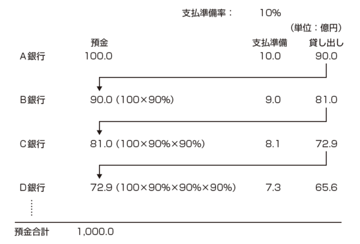

### この話では
預かったお金をスタートラインに話をしていますが、それですら実際は異なり....

えーーーー??????

### 例2
1. A さんが X 銀行に 10 万円借りたいといった
2. X 銀行は A さんに口座をつくらせ、そこに 10 万と数字を書いた (入力した)

こちらの方がわかりやすいですね (信じられないけど)

銀行は返済能力のある借り手さえいれば、資金の制約を受けずにいくらでも貸し出しを行うことができます。

ただし、先ほど言ったように準備預金は法令で義務付けられています。(実際は 0.05-1.2%)

- [準備預金制度における準備率　公表データ](https://www.boj.or.jp/statistics/boj/other/reservereq/junbi.htm)

### つまり
- 銀行はみんなが預けたお金を他の人に貸して運用している

という見解は間違えということになります。

#### 自民党の西田議員が日本銀行総裁に確認している動画
<!--
- [西田昌司 お金の正体＝信用創造 20190404](https://www.youtube.com/watch?v=bk6qhR_AWXg)
  -->
- [西田昌司　参議院決算委員会質問（2019.4.4） お金の正体 22:03-24:15](https://youtube.com/watch?v=FcT-KqWqOdo&t=1323)

<!--
- [【参議院】信用創造【財政金融委員会】](https://www.youtube.com/watch?v=_6O52UDE9tY)
-->

### 信用創造まとめ
> 信用創造とは銀行が融資（貸し出し）を行うことで、社会全体の預金通貨（おカネ）を新しく生み出す仕組みのことです。

**誰かが借りるとマネーストックが増える** という仕組みになっています。

### 現在経済が悪くなっている原因
コロナで経済が悪くなっている？

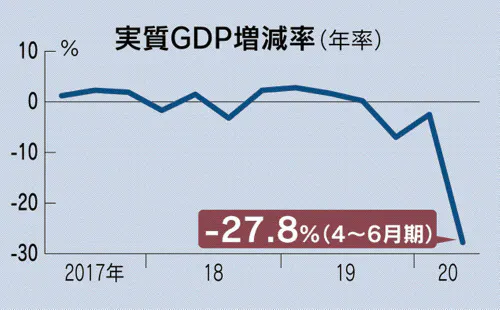

コロナになる前から経済状況は悪くなっている。

### 実質賃金の推移
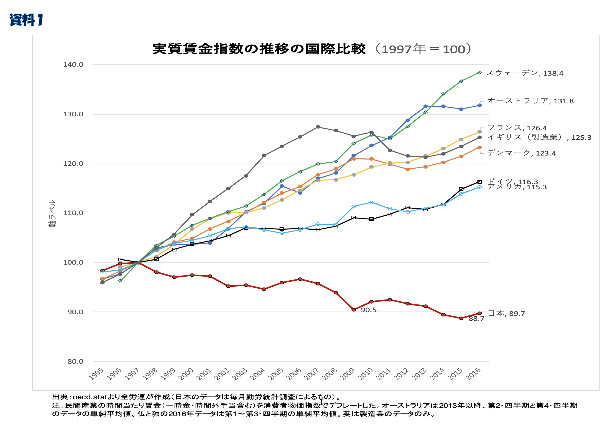

### 日本の状況
物価の影響を加味した実質賃金は、この30年ほど下がっていて、他の国は安定して増えている。

**ジャパンアズナンバーワン**(エズラ・ヴォーゲル 1979)と言われた日本が、なぜこうなってしまったのだろうか？

### 原因
いろいろなことが言われています。
- 人口減少(少子高齢化)
- 古い産業構造
- IT化の遅れ
- 消費税増税

調べればまだまだ出てくるでしょう

### 政治家は何をしたの？
色々トライしましたが、今のところ改善の見込みが立っていません。

異次元の金融緩和をしてマネタリーベース(銀行同士が扱えるお金)は確かに増えました。でも、民間(マネーストック)にはお金が回ってこない。

企業が最高益を上げても、内部留保で積まれているだけです。

- [上場企業の24年3月期、3年連続最高益　車と電力がけん引](https://www.nikkei.com/article/DGXZQOUC2078U0Q4A520C2000000/)
<!--
- [企業の内部留保、６００兆円　１２年連続で過去最高―投資や人件費、活用に課題・２３年度末](https://www.jiji.com/jc/article?k=2024090200824&g=eco)-->
- [昨年度の法人企業統計、経常利益は８・８％増と５年連続増…内部留保は１４年連続で過去最大更新](https://www.yomiuri.co.jp/economy/20260901-GYT1T00087/)

### 名目GDP・マネタリーベース・マネーストック

### なぜ？
通常なら
- 銀行はお金を貸して儲けようと思う
- 企業は投資して儲けようと思う

今起きてることは
> 借りて投資しても儲ける見込みがないから借りない

なぜそう思うかというと
> みんなお金を使うのをやめているから

そのため、マネーストックは上がらない

### GDPってなんだっけ？
> GDP=民間消費+民間投資+政府支出+純輸出

これが経済成長率の指標として利用されている。この 4 つのどれかが上がれば、GDP はあがるのに、名目 GDP はこの 2,30 年全然上がってい ない。
どうすれば成長するんだろう?

この 4 つの項目について検討してみるよ。

### 1.民間消費(GDPの約6割)
例えばコロナで特定給付金として 10 万円もらったら経済効果は 3.5 兆円程度、 GDP を 0.7%押しあげたんだ。

政府がお金をみんなに配れば、そりゃ消費活動するので伸びるよね。

逆に、消費税の税率をあげれば、実質利用できるお金が減ってしまうので、消費しなくなるよね。

### 消費税10%の意味
毎月 10 万円稼いでる人が全部消費にあてていたとすると、 1 年間経っ た時に、仮に消費税がゼロだとすると、ざっくり10 万円 (一ヶ月分の収入) が手元に残っている計算になるよ。

それだけ残ってたら、好きなもの買って消費伸びるよね。

### 消費税の目的
後世にツケを残さないために社会保障費をみんなで負担しましょう、という触れ込みでした。

消費税法第一条 2
> 消費税の収入については、地方交付税法（昭和二十五年法律第二百十一号）に定めるところによるほか、毎年度、制度として確立された年金、医療及び介護の**社会保障給付**並びに**少子化に対処するため**の施策に要する経費に充てるものとする。

### 本当に?
<!--
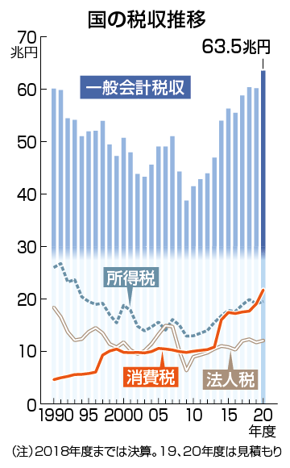
-->
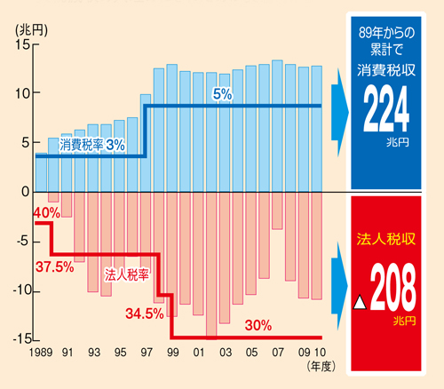

### 本当に?
<!--

-->
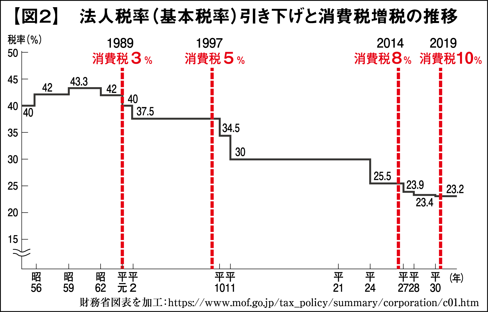

### 2010年までは消費税があがる一方、所得税や法人税を減らしてきた。

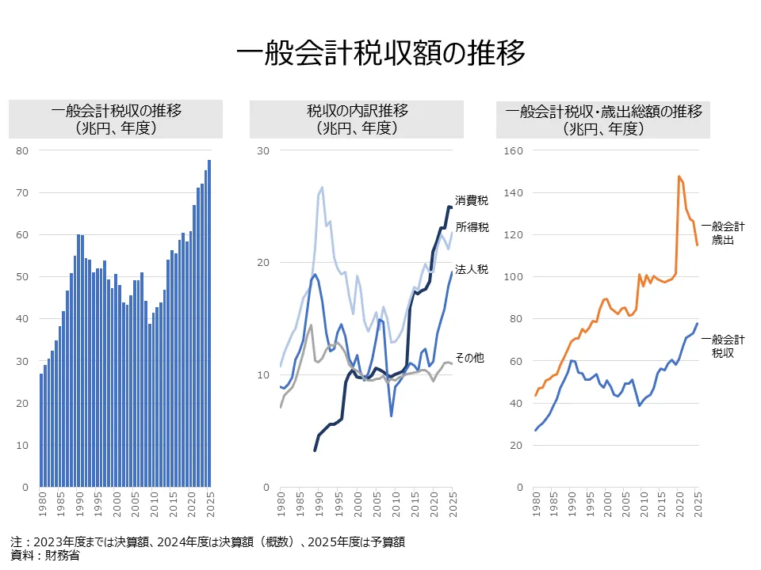

<!--
### ちょっと古いけど...1990,2018年度比較
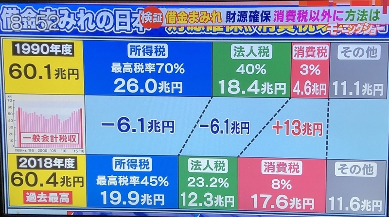
-->

### そもそも...
税収って、強制的に消費税10%にする強制徴収をおいておけば、

1. 景気が良くなれば
2. みんなの収入(個人・企業含む)が増えて
3. 税収増えるはずですよね。

逆に
1. 景気が悪くなれば
2. みんなの収入(個人・企業含む)が減って
3. 税収減るはずですよね。

6年連続で税収は過去最高を更新しています。
- [昨年度税収８４兆２２２６億円　６年連続で過去最高―財務省](https://www.jiji.com/jc/article?k=2026070301045&g=eco)

### おまけ
ちなみに、物価上がると、消費税上がるの気づいてるかな？

例えば
- 1000円の消費税って100円
- 物価が1.5倍になったら消費税150円

**物価と連動して自動的に税額が上がる**システムとなっています。

### 2.民間投資(GDPの約2割)
人の消費が多くなれば、「これなら儲けられるかも」と投資する人も増えるよね。

これは、民間消費と連動している。

### 例えば
- タピオカブームの時、タピオカの店が増えた
- 鬼滅が流行れば、乗っかったキャンペーンすごく増えた

### 3. 政府支出
コロナの特定給付金の 10 万は、政府が国債を発行して借金して、政府支出が伸びたことを意味します。

政府が公共投資や給付金や公務員を増やすなど支出を増やすことは政治の決定において可能ということになります。

### 4. 純輸出
海外から人が来て、お金を使ってくれれば純輸出はあがる。
日本のインバウンド（訪日外国人旅行）消費額の対GDP比は、直近のデータで約1.3%前後

<!--
- [インバウンド需要の拡大と地域差](https://www5.cao.go.jp/j-j/cr/cr18/chr18_02-01.html)
- -->
- [訪日外国人旅行者数・出国日本人数](https://www.mlit.go.jp/kankocho/tokei_hakusyo/shutsunyukokushasu.html)

一方、海外のデジタルサービスを利用することにより、デジタル赤字が増えています。

- [デジタル赤字とは？——日本経済が直面する「デジタル敗戦」と政策の課題](https://news.yahoo.co.jp/expert/articles/e340244e9c45b634d5a5c0a403579c3ce7d34955)

### GDP を伸ばす方法まとめ
> GDP=民間消費+民間投資+政府支出+純輸出

4 つの項目について伸ばす方法をまとめると
- 消費税を減らす
- 政府が支出を増やす
  
ことが有意義に見える。

> GDP=国内総生産=国内総支出

つまり、これらの方法を取れば、君たちの所得も上がるかも！

### でも...
- [「国の借金」１３４２兆１７２０億円、過去最大を更新…日本のＧＤＰの２・３倍に](https://www.yomiuri.co.jp/economy/20260210-GYT1T00372/)

> 国民１人当たりの借金額は、単純計算で約１０９０万円。国の借金総額は今年３月末にはさらに膨らみ、１４７３兆円に達すると見込まれている。
<!--
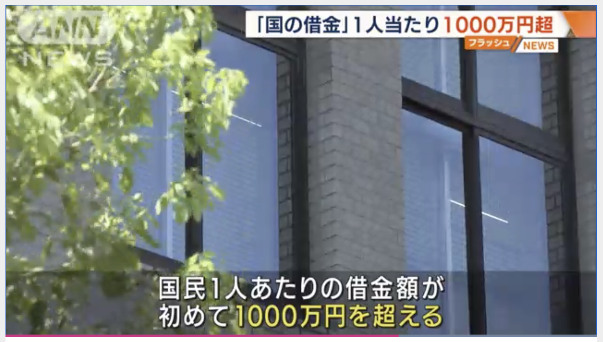
[「国の借金」1255兆円　国民1人当たり1000万円超 2022/08/11](https://news.tv-asahi.co.jp/news_economy/articles/000264752.html)
-->

### 破綻するの？
自分の家計と政府の懐事情を考えると、政府の借金が膨大になりすぎて、破綻するんじゃないの？と思うよね？

だって、借金はいつか返さなきゃいけないから、後世の子どもたちにツケを回しちゃいけないよね、とか考えちゃうよね？

### 民間と政府が異なるところ
皆さんが借金したら、返さなくてはいけません。返せなくなった場合には、自己破産手続きをとることになります。

また、勝手にお金を作ることは違法です(捕まります)。

でも、「自国通貨発行権」という言葉があります。

国は自国通貨、つまり「円」を発行できるわけです。

### ギリシャは破綻...
ギリシャでは2009年に破綻の可能性が発覚しました。

ユーロ建で借金をしていました。
ギリシャはユーロを発行できません。ので、返済できなくなると破綻するので、EU各国が支援するということになりました。

日本も第二次世界大戦時には英ポンド・米ドル・仏フラン建による国債を発行して戦時資金を賄い、これは 1980 年代まで返済をしていました。(みんなにとっては昔の話だけど、自分にとっては高校生の頃のことだから、わりと知られてないびっくりする話でした)

### 「円」を発行できるなら？
ギリシャと異なり、日本は「円」を発行できます。

ん？

ってことは、
> **借金があっても、円を発行すれば返せるんじゃない？**

### ここが現在の議論となっているところ
現在、この「打ち出の小槌」みたいな考え方の賛否が非常に問われています。

### 財務省も...
日本国債の格付けを海外の会社が引き下げた時にこんな意見書を出しました。

> 日・米など先進国の自国通貨建国債のデフォルトは考えられない。デ フォルトとして如何なる事態を想定しているのか。
[(外国格付け会社宛意見書要旨)](https://www.mof.go.jp/about_mof/other/other/rating/p140430.htm)

「デフォルト」とは債務不履行、つまり、もうお金返せませーーん、という破綻を意味します。

### 破綻する人の言い分
自国通貨建だとしても借金を増やすと円の価値が暴落してしまい
- 海外からの信用がなくなる
- ハイパーインフレが起こる

という主張をしています。

> ハイパーインフレとは**インフレーション率が毎月50％を超えること**で、一年後には物価が129.75倍に上昇することになります。

### ちなみに...
異次元の金融緩和にて、マネタリーベースを増やし続けたことは、事実 ここ 10 年近く行ってきたことです。

- 海外からの信用はなくなったでしょうか?
- ハイパーインフレが起きたでしょうか?

### 1. 国債の金利は?
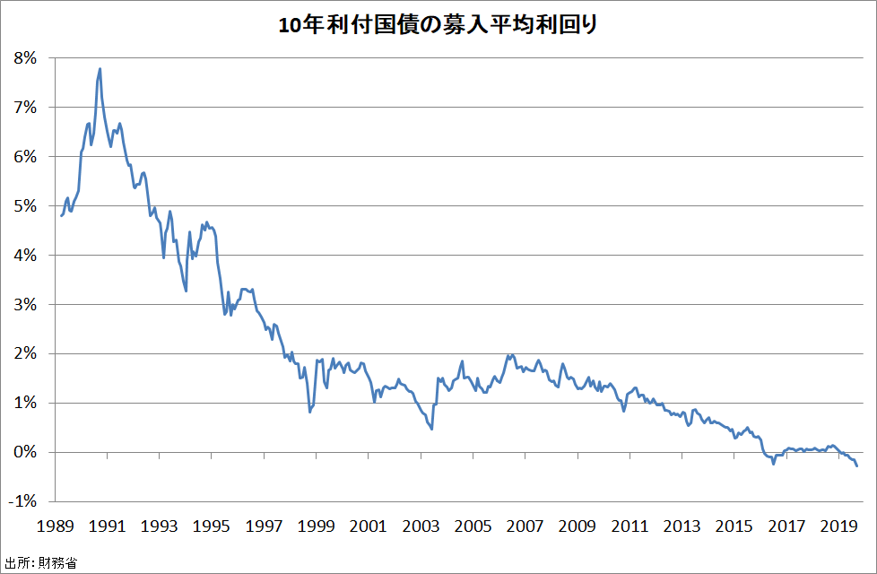

### 2. ハイパーインフレ?
<!--

価格が暴騰する状態になっていますか？
目指した2%に届いてすらいません。
(現在はコストプッシュインフレで物価上がってます)
-->
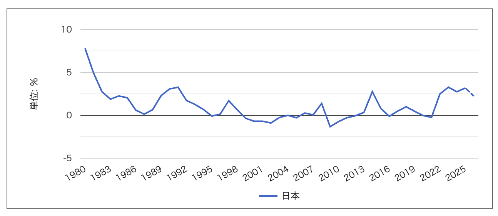
- [日本のインフレ率の推移](https://ecodb.net/country/JP/imf_inflation.html)

### 破綻しないという人の意見
いくらでもお金を作ってよい、といっているわけではなく、
- 政府の借金額の大きさは破綻と関係ない
- インフレ率が高騰しない限り、お金を刷って良い

となります。

「打ち出の小槌」的な、「お金刷れば税金なんか取る必要ないじゃん」という主張とは異なります。

<!--
### MMT
この破綻しないといっている理論を MMT(現代貨幣理論) といい、 自国通貨を発行できる政府は、インフレにならない限り、

> 大量の国債発行をある程度許容する

との主張にまとまります。
-->

### そして
限度を超えない限り国債発行をして
- インフラ整備の拡大
- 社会保障の充実
- 雇用の増加

を行えるとしています。

### これから日本はどうするべきか？
- 緊縮財政
- 反緊縮財政(積極財政)

の二つの考え方があります。

### 二つの違い
#### 緊縮財政
プライマリーバランス黒字化...つまり、政府の歳入と歳出 を同じにさせ、これ以上政府の借金を増やさない様にしよう という立場
#### 反緊縮財政
インフレ率に注視しながら、積極的に政府がお金を使っていこうという立場

これらは、財政に対する考え方の違いです。

### 現在は緊縮財政派が多い?
**財政再建・プライマリーバランス黒字化**という言葉を使う人は緊縮財政派です。

コロナにおいても、支援は対してせずに、精神論で乗り越えようとします。

反緊縮財政の人は、お金を使ってみんなの生活を保障しながら、コロナを乗り切ろうとします。

現在、減税の議論が行われていますが、これに対して「財源は？」と聞く人は緊縮財政派ということになります。

### コロナで各国はどう動いた？
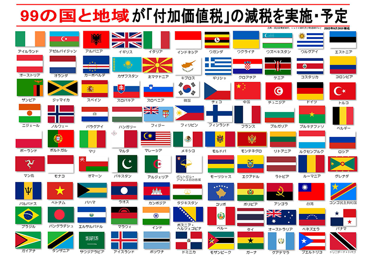

### コロナ後景気
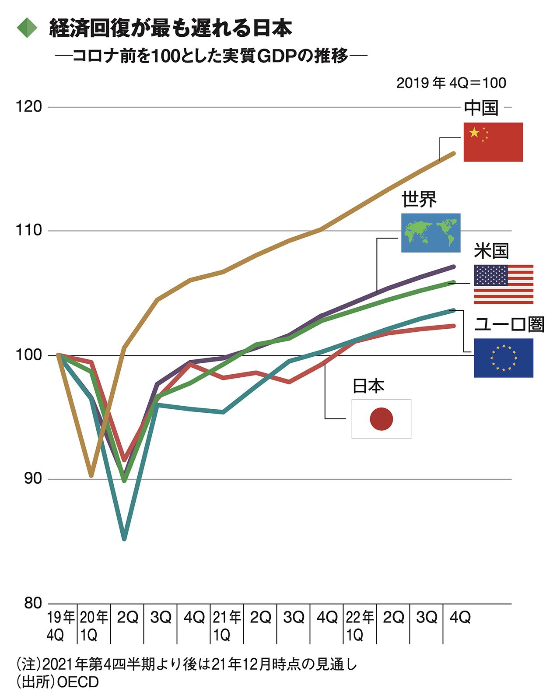

[コロナ後の日本経済はどう変わるのか？](https://toyokeizai.net/articles/-/577643)

### 現在
これまでプライマリーバランスの黒字化を目標としてきましたが、
2025年10月に「責任ある積極財政」と、方針を変えてきました。

「政府債務残高の対GDP比」を着実に低下させることに目標を変えてきています。

### さて
あなたは
- 緊縮財政
- 反緊縮財政

どちらが良いと思いますか？

### いずれにせよ
みんなが、適切な経済行為を行い、それによって豊かになっていけるような世の中になればよいのだけれど、今の社会何かがおかしいので、どんなに頑張っても豊かになれない仕組みになってしまっていることを憂いています。

貧困が拡大し、多くの人にとって生活するのがやっとになってしまえば、 日本の持つ様々な供給力も減ってしまい、本当に経済が回らなくなってしまいます。

どんなに一生懸命に一人一人が働いていても、そんな仕組みの中に生きているのです。
少しでも興味を持ってどうあるべきか考えて欲しいと思います。

### 課題
あなたは緊縮財政・反対緊縮財政、どちらの立場をとりますか? 400 字程度でまとめよ。

---
---
---
---
---

# 24回目
## 信用創造
### 銀行とお金
銀行って、金庫にお金がたくさん詰まっていると思いませんか？

本当でしょうか？

### お金について
物々交換が行われていましたが、
直接交換すると大変なので、
お金が生まれます。

最初は貝殻をお金として利用していたようです。

そのため、
> 財、貯、買、貸、貨、販、資、購

など、お金に関する感じには「貝」が使われているという説があります。

### 金本位制
その後、1816年に金本位制と呼ばれる制度が生まれます
> 金を通貨の価値基準とする制度で、
> 各国の中央銀行が発行する紙幣と同額の金を保有し、
> いつでも相互に交換することを保証するものです

日本では1897年に採用され、0.75g=1円と定められます。

### 金本位制の中断
第一次世界大戦により、金本位制は中断することとなります。

戦争によって増大した対外支払のために
金貨の政府への集中が必要となり、
金の輸出を禁止、通貨の金兌換を停止せざるをえなくなったからと言われています。

### 金本位制への復帰、そして離脱
1919年にアメリカ合衆国が金本位制に復帰したのを皮切りに、
各国も次々と復帰したが、
1929年の世界大恐慌により再び機能しなくなり、
1931年9月のイギリスを契機として1937年6月のフランスを最後に
すべての国が金本位制を離脱した。

### 金とドル
第二次世界大戦後、米ドル金為替本位制を中心とした
IMFによる体制、所謂「ブレトン・ウッズ体制」が創設された。

間接的に金と結びつく形での金本位制となったのである。

1971年8月15日のいわゆるニクソン・ショック以降は、
金と米ドルの兌換が停止される。

1976年1月にキングストンで開催されたIMF暫定委員会では、
変動相場制と米ドルの金本位制廃止が確認され、
1978年4月に協定発効に伴って先進国の
通貨における**金本位制は完全に終焉**した。

### そして管理通貨制度へ
管理通貨制度とは、
中央銀行や財務省などの通貨当局が、
金準備に拘束されずに通貨の発行量を政策的に管理する制度です。

### 金という裏付けが全くない貨幣
あなたたちが現在利用しているお金は
「金」と交換できるという裏付けは全くなく、

その国の政治や経済状況が貨幣の価値が決まる状態となっています。

### 銀行とお金
銀行って、金庫にお金がたくさん詰まっていると思いませんか？

本当でしょうか？

### 預金準備制度
準備預金制度とは、対象となる金融機関に対して、「受け入れている預金 などの一定比率 (これを準備率という) 以上の金額を日本銀行に預け入れること」を義務付ける制度です。
(日本銀行)

-[準備預金制度とは何ですか？　超過準備とは何ですか？](https://www.boj.or.jp/announcements/education/oshiete/seisaku/b33.htm/)

### 預金
- 銀行口座に預けたお金はいつでも現金に払い戻しができる。
- つまり、あなたが、お金を銀行に貸している状態です。
その一定比率は日本銀行に預けなくてはいけない、ということですね。

んじゃ、残りは?

### あまらせとくのもったいないよね
だから、誰かに貸しちゃうんです。

 ... すると何がおきてる?

### 例1
1. A さんが 100 円を X 銀行に預けます。
2. 預金準備率を 10%だとすると、X 銀行は 10 円を日本銀行に預けます。
3. X 銀行には 90 円残ります。
4. X 銀行は B さんに 90 円貸します。B さんは C さんにお金を支払うと、C さんが Y 銀行に預金しました。

この時、X 銀行と Y 銀行の中にある現金の総額は 100 円ですが、通帳残 高の総額は 190 円になってないですか?

お金が生まれてしまっていますね。これを続けると、お金は膨れ上がるんです。
100 億円の現金があれば 1000 億円の通帳算高を生み出したことになります。これを**信用創造**といいます。

### 

### この話では
預かったお金をスタートラインに話をしていますが、それですら実際は異なり....

えーーーー??????

### 例2
1. A さんが X 銀行に 10 万円借りたいといった
2. X 銀行は A さんに口座をつくらせ、そこに 10 万と数字を書いた (入力した)

こちらの方がわかりやすいですね (信じられないけど)

銀行は返済能力のある借り手さえいれば、資金の制約を受けずにいくらでも貸し出しを行うことができます。

ただし、準備預金は法令で義務付けられています。(実際は 2~0.05%)

### つまり
- 銀行はみんなが預けたお金を他の人に貸して運用している

という見解は間違えということになります。

### 自民党の西田議員が日本銀行総裁にきいている動画
<!--
- [西田昌司 お金の正体＝信用創造 20190404](https://www.youtube.com/watch?v=bk6qhR_AWXg)
  -->
- [西田昌司　参議院決算委員会質問（2019.4.4） お金の正体 -24:15](https://youtube.com/watch?v=FcT-KqWqOdo&t=1323)

<!--
- [【参議院】信用創造【財政金融委員会】](https://www.youtube.com/watch?v=_6O52UDE9tY)
-->

### お金とはなんなんだろう？
今日はお金に対しての基礎的な考え方がひっくりかえってくれれば嬉しいです。

### 課題
信用創造についてどうおもいますか? 400 字程度でまとめよ。

---
---
---
# 25回目
### 今日の内容
今日の内容、これまでいろんな用語や考え方を説明してきました。
これらを使って、現状を説明したいと思います。

個人的見解も入っていますが、なるべく中立に説明するつもりです。

### 現在経済が悪くなっている原因
コロナで経済が悪くなっている？

コロナになる前から経済状況は悪くなっている。

### 実質賃金の推移

### 日本の状況
物価の影響を加味した実質賃金は、この30年ほど下がっていて、他の国は安定して増えている。

**ジャパンアズナンバーワン**(エズラ・ヴォーゲル 1979)と言われた日本が、なぜこうなってしまったのだろうか？

### 原因
いろいろなことが言われています。
- 人口減少(少子高齢化)
- 古い産業構造
- IT化の遅れ
- 消費税増税

調べればまだまだ出てくるでしょう

### 政治家は何をしたの？
色々トライしましたが、今のところ改善の見込みが立っていません。

異次元の金融緩和をしてマネタリーベース(銀行同士が扱えるお金)は確かに増えました。でも、民間(マネーストック)にはお金が回ってこない。

企業が最高益を上げても、内部留保で積まれているだけです。

- [上場企業の24年3月期、3年連続最高益　車と電力がけん引](https://www.nikkei.com/article/DGXZQOUC2078U0Q4A520C2000000/)
- [企業の内部留保、６００兆円　１２年連続で過去最高―投資や人件費、活用に課題・２３年度末](https://www.jiji.com/jc/article?k=2024090200824&g=eco)

### 名目GDP・マネタリーベース・マネーストック

### なぜ？
通常なら
- 銀行はお金を貸して儲けようと思う
- 企業は投資して儲けようと思う

今起きてることは
> 借りて投資しても儲ける見込みがないから借りない

なぜそう思うかというと
> みんなお金を使うのをやめているから

そのため、マネーストックは上がらない

### GDPってなんだっけ？
> GDP=民間消費+民間投資+政府支出+純輸出

これが経済成長率の指標として利用されている。この 4 つのどれかが上がれば、GDP はあがるのに、名目 GDP はこの 2,30 年全然上がってい ない。
どうすれば成長するんだろう?

この 4 つの項目について検討してみるよ。

### 1.民間消費(GDPの約6割)
例えばコロナで特定給付金として 10 万円もらったら経済効果は 3.5 兆円程度、 GDP を 0.7%押しあげたんだ。

政府がお金をみんなに配れば、そりゃ消費活動するので伸びるよね。

逆に、消費税の税率をあげれば、実質利用できるお金が減ってしまうので、消費しなくなるよね。

### 消費税10%の意味
毎月 10 万円稼いでる人が全部消費にあてていたとすると、 1 年間経っ た時に、仮に消費税がゼロだとすると、10 万円 (一ヶ月分の収入) が手元に残っている計算になるよ。

それだけ残ってたら、好きなもの買って消費伸びるよね。

### 消費税の目的
後世にツケを残さないために社会保障費をみんなで負担しましょう、という触れ込みでした。

消費税法第一条 2
> 消費税の収入については、地方交付税法（昭和二十五年法律第二百十一号）に定めるところによるほか、毎年度、制度として確立された年金、医療及び介護の**社会保障給付**並びに**少子化に対処するため**の施策に要する経費に充てるものとする。

### 本当に?

### 実際は
消費税があがる一方、所得税や法人税が減っていて、税収自体は増えていません。(消費税10%になってから、税収上がってるけど)

### ちょっと古いけど...1990,2018年度比較

### そもそも...
税収って、強制的に消費税10%にする強制徴収をおいておけば、

1. 景気が良くなれば
2. みんなの収入(個人・企業含む)が増えて
3. 税収増えるはずですよね。

逆に
1. 景気が悪くなれば
2. みんなの収入(個人・企業含む)が減って
3. 税収減るはずですよね。

### おまけ
ちなみに、物価上がると、消費税上がるの気づいてるかな？

例えば
- 1000円の消費税って100円
- 物価が1.5倍になったら消費税150円

物価と連動して自動的に税額が上がるシステムとなっています。

### 2.民間投資(GDPの約2割)
人の消費が多くなれば、「これなら儲けられるかも」と投資する人も増えるよね。

これは、民間消費と連動している。

### 例えば
- タピオカブームの時、タピオカの店が増えた
- 鬼滅が流行れば、乗っかったキャンペーンすごく増えた

### 3. 政府支出
コロナの特定給付金の 10 万は、政府が国債を発行して借金して、政府支出が伸びたことを意味します。

政府が公共投資や給付金や公務員を増やすなど支出を増やすことは政治の決定において可能ということになります。

### 4. 純輸出
海外から人が来て、お金を使ってくれれば純輸出はあがる。
インバウンドってGDP比でいえば2017年(コロナ前)で1.2%

[インバウンド需要の拡大と地域差](https://www5.cao.go.jp/j-j/cr/cr18/chr18_02-01.html)

### GDP を伸ばす方法まとめ
> GDP=民間消費+民間投資+政府支出+純輸出

4 つの項目について伸ばす方法をまとめると
- 消費税を減らす
- 政府が支出を増やす
  
ことが有意義に見える。

> GDP=国内総生産=国内総支出

つまり、これらの方法を取れば、君たちの所得も上がるかも！

### でも...

[「国の借金」1255兆円　国民1人当たり1000万円超 2022/08/11](https://news.tv-asahi.co.jp/news_economy/articles/000264752.html)

### 破綻するの？
自分の家計と政府の懐事情を考えると、政府の借金が膨大になりすぎて、破綻するんじゃないの？と思うよね？

だって、借金はいつか返さなきゃいけないから、後世の子どもたちにツケを回しちゃいけないよね、とか考えちゃうよね？

### 民間と政府が異なるところ
皆さんが借金したら、返さなくてはいけません。返せなくなった場合には、自己破産手続きをとることになります。

また、勝手にお金を作ることは違法です(捕まります)。

でも、「自国通貨発行権」という言葉があります。

国は自国通貨、つまり「円」を発行できるわけです。

### ギリシャは破綻...
ギリシャでは2009年に破綻の可能性が発覚しました。

ユーロ建で借金をしていました。
ギリシャはユーロを発行できません。ので、返済できなくなると破綻するので、EU各国が支援するということになりました。

日本も第二次世界大戦時には英ポンド・米ドル・仏フラン建による国債を発行して戦時資金を賄い、これは 1980 年代まで返済をしていました。(みんなにとっては昔の話だけど、自分にとっては高校生の頃のことだから、わりと知られてないびっくりする話でした)

### 「円」を発行できるなら？
ギリシャと異なり、日本は「円」を発行できます。

ん？

ってことは、
> **借金があっても、円を発行すれば返せるんじゃない？**

### ここが現在の議論となっているところ
現在、この「打ち出の小槌」みたいな考え方の賛否が非常に問われています。

### 財務省も...
日本国債の格付けを海外の会社が引き下げた時にこんな意見書を出しました。

> 日・米など先進国の自国通貨建国債のデフォルトは考えられない。デ フォルトとして如何なる事態を想定しているのか。
[外国格付け会社宛意見書要旨](https://www.mof.go.jp/about_mof/other/other/rating/p140430.htm)

「デフォルト」とは債務不履行、つまり、もうお金返せませーーん、という破綻を意味します。

### 破綻する人の言い分
自国通貨建だとしても借金を増やすと円の価値が暴落してしまい
- 海外からの信用がなくなる
- ハイパーインフレが起こる

という主張をしています。

> ハイパーインフレとは**インフレーション率が毎月50％を超えること**で、一年後には物価が129.75倍に上昇することになります。

### ちなみに...
異次元の金融緩和にて、マネタリーベースを増やし続けたことは、事実 ここ 10 年近く行ってきたことです。

- 海外からの信用はなくなったでしょうか?
- ハイパーインフレが起きたでしょうか?

### 1. 国債の金利は?

### 2. ハイパーインフレ?

価格が暴騰する状態になっていますか？
目指した2%に届いてすらいません。
(現在はコストプッシュインフレで物価上がってます)

### 破綻しないという人の意見
いくらでもお金を作ってよい、といっているわけではなく、
- 政府の借金額の大きさは破綻と関係ない
- インフレ率が高騰しない限り、お金を刷って良い

となります。

「打ち出の小槌」的な、「お金刷れば税金なんか取る必要ないじゃん」という主張とは異なります。

<!--
### MMT
この破綻しないといっている理論を MMT(現代貨幣理論) といい、 自国通貨を発行できる政府は、インフレにならない限り、

> 大量の国債発行をある程度許容する

との主張にまとまります。
-->

### そして
限度を超えない限り国債発行をして
- インフラ整備の拡大
- 社会保障の充実
- 雇用の増加

を行えるとしています。

### これから日本はどうするべきか？
- 緊縮財政
- 反緊縮財政

の二つの考え方があります。

### 二つの違い
#### 緊縮財政
プライマリーバランス黒字化...つまり、政府の歳入と歳出 を同じにさせ、これ以上政府の借金を増やさない様にしよう という立場
#### 反緊縮財政
インフレ率に注視しながら、積極的に政府がお金を使っていこうという立場

これらは、財政に対する考え方の違いです。

### 現在は緊縮財政派が多い?
**財政再建・プライマリーバランス黒字化**という言葉を使う人は緊縮財政派です。

コロナにおいても、支援は対してせずに、精神論で乗り越えようとします。

反緊縮財政の人は、お金を使ってみんなの生活を保障しながら、コロナを乗り切ろうとします。

現在、減税の議論が行われていますが、これに対して「財源は？」と聞く人は緊縮財政派ということになります。

### コロナで各国はどう動いた？

### コロナ後景気

[コロナ後の日本経済はどう変わるのか？](https://toyokeizai.net/articles/-/577643)

### さて
あなたは
- 緊縮財政
- 反緊縮財政

どちらが良いと思いますか？

### いずれにせよ
みんなが、適切な経済行為を行い、それによって豊かになっていけるような世の中になればよいのだけれど、今の社会何かがおかしいので、どんなに頑張っても豊かになれない仕組みになってしまっていることを憂いています。

貧困が拡大し、多くの人にとって生活するのがやっとになってしまえば、 日本の持つ様々な供給力も減ってしまい、本当に経済が回らなくなってしまいます。

どんなに一生懸命に一人一人が働いていても、そんな仕組みの中に生きているのです。
少しでも興味を持ってどうあるべきか考えて欲しいと思います。

### 来週について
あと1回...国債についてもう少し詳しく説明したいと思います。

### 課題
あなたは緊縮財政・反対緊縮財政、どちらの立場をとりますか? 400 字程度でまとめよ。

---
---
---
# 26回目
## 前回のレポートを見て思ったこと
### 前回のレポート内容
> あなたは緊縮財政・反緊縮財政、どちらの立場をとりますか? 400 字程度でまとめよ。

初めに、二つの立場で議論がある、と説明しました。

適当にググると何が起こるでしょうか？

### ググった検索結果
二つの立場で議論があるわけなので、

- 緊縮財政の立場で書いてある記事
- 反緊縮財政の立場で書いてある記事
- 中立に両方を紹介している記事

の3種類に分かれます。

### ネットの情報はそもそも正しいのか？
「緊縮財政の立場で書いてある記事」「反緊縮財政の立場で書いてある記事」を選んでその内容にてレポート書いた人、非常に危険です。

自分で考えることなしに人の意見を鵜呑みにしてしまっています。

Google検索の1番上に掲載されたものから見る人が多いでしょうから、Googleさんに思考をコントロールされる、とも言えるでしょう。

### メディアリテラシー
メディアの機能を理解するとともに、あらゆる形態のメディア・メッセージを調べ、批判的に分析評価し、創造的に自己表現し、それによって市民社会に参加し、異文化を超えて対話し、行動する能力である。

ユネスコでは以下のように定義しているようです。
- 民主主義社会におけるメディアの役割と機能を理解する。
- メディアがその機能を十分に発揮しうる条件を理解する。
- メディア機能の観点からメディア・コンテンツを批判的に評価する。
- 自己表現、異文化間対話、民主主義的参加のためにメディアに取り組む。
- ユーザー・コンテンツを創造するのに必要なスキル（ICTを含む）を身につけて用いる。

[wikipedia](https://ja.wikipedia.org/wiki/%E3%83%A1%E3%83%87%E3%82%A3%E3%82%A2%E3%83%BB%E3%83%AA%E3%83%86%E3%83%A9%E3%82%B7%E3%83%BC)

### 情報に対して批判的な立場を持とう
複数の立場がある問題について考えるときには、双方の意見を読み解き、どちらが正しいかを選択することが必要になってきます。

- マスク・ワクチンに関しても様々な意見が飛び交っています。
- 斉藤知事に関しても様々な意見が飛び交っています。

自分で判断することが必要です。

### 社会に出ると
正解のない問題にばかりぶつかります。

自分の頭で考えて、判断する、という癖をつけて欲しいものです。
Googleさんはヒントは与えてくれますが、正解を教えてくれるわけではありません。

### みなさんも経験したばかり...
就活・進路を決める、ということには正解がありません。

その中で選択をしなくてはいけません。

### 政治や経済に興味ない...
今、実感がないことはよくわかります。

ですが、これは**あなたの生きる環境を選択する**ということにつながります。

半分の人が興味がない、と投票権を放棄することで(衆議院選挙2024 投票率53.85%)、組織票を持っている...つまり、国民一人一人ではなく、企業や団体の意見で全て世の中が決まっていくこととなります。

### 国民負担率
国税や地方税の租税負担と、年金や健康保険の保険料など社会保障負担の総合計額が国民所得に占める 割合のこと

つまり、稼いだ所得のうちどのくらい持っていかれるか？ということを表します。

1980年には30%だったものが、2021年には48%にまで膨れ上がっています。その後、少し低下し2024年には45.1%になる見通し。

- [2021年度の租税・社会保障負担率（国民負担率）は48.0％、前年度から0.1ポイント増―財務省](https://gemmed.ghc-j.com/?p=46207)
- [24年度の国民負担率45%　国民所得拡大で2年連続縮小へ(国民所得の伸びが負担増を上回るため)](https://www.nikkei.com/article/DGXZQOUA098W80Z00C24A2000000/)

稼いだお金の半分近くが持ってかれてます。

国民負担率は上がる一方、社会保障が手厚くなっていれば、それはそれで問題ないのですが...

## 国の借金
### 今日の話の流れ
色々用語については説明してきました。今日もなるべく説明はします。

1. 現在日本は景気が悪い
2. **景気が悪い時は減税**は、教科書にも書いてある普通のこと
3. 減税すると財政が悪化するため、**景気が悪いにもかかわらず増税**してきた
4. **国の借金は国債**だが、本当にこれは増えると本当にまずいのか？で議論がある。
5. この方向(**増税・減税**)間違えると、日本の景気に大きな影響を与える
6. 国債について考えてみよう

### 経済だけの話ではなく...
経済について説明してきましたが、**政治的判断**というのものが関係する領域に入っていきます。

政治的判断によって政治が動いていきますが、
- 政治家を選ぶのはあなた方一人一人
- 国民主権(国民が国の在り方を最終的に決定する最高の力を有する存在)

ということを意識していきましょう。

### 国民一人当たりの借金
給付金を国民が10万円ずつもらったら、国は赤字になりました。でも、国民は黒字になりました。

国が借金して、国民に支払うと国民が黒字になるのに
「国民一人当たりの借金は...」という言い方は完全にミスリード???

### 誰が国に貸してるの？
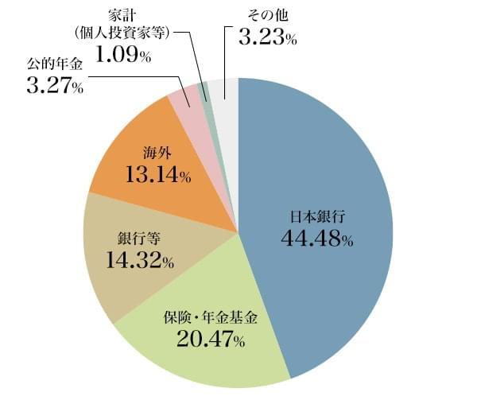

https://www.nomura.co.jp/el_borde/article/0016/

### 日本銀行が半分近く占めている
国債は日本銀行が半分近く保有しています。

が、政府から日本銀行は直接国債は買えません。

???

### 日本銀行は直接国債を買うことはない
>財政法第5条：
すべて、公債の発行については、日本銀行にこれを引き受けさせ、又、借入金の借入については、日本銀行からこれを借り入れてはならない。但し、特別の事由がある場合において、国会の議決を経た金額の範囲内では、この限りでない。

中央銀行がいったん国債の引受けによって政府への資金供与を始めると、その国の政府の財政節度を失わせ、ひいては中央銀行通貨の増発に歯止めが掛からなくなり、悪性のインフレーションを引き起こすおそれがあるからです。そうなると、その国の通貨や経済運営そのものに対する国内外からの信頼も失われてしまいます。これは長い歴史から得られた貴重な経験であり、わが国だけでなく先進各国で中央銀行による国債引受けが制度的に禁止されているのもこのためです。

[日本銀行が国債の引受けを行わないのはなぜですか？](https://www.boj.or.jp/announcements/education/oshiete/op/f09.htm/)

### でも？45%くらい日本銀行持ってるじゃん...
1. 国債は銀行などが引き受けます。(政府->銀行)
2. 銀行から日本銀行は国債を買い上げます(銀行->日本銀行)

この時のお金の流れは、日銀当座預金の中で行われ
1. 銀行から政府へ(これで政策実行が可能となります)
2. 日本銀行から銀行へ(日本銀行は通貨発行権を持っています)

結果、マネタリーベース(日銀当座預金と紙幣の合計)が増えます。

### 銀行が国債買わなくなったら？
国債の引き受け手がいなくなったら困る、という議論があります。

1. 日本銀行がマイナス金利政策をとると(現在0.1%)、預けているだけでお金が減る
2. 政府から国債(国債10年：1.075%)を買えば、利子がつく
3. よって、銀行に国債を買わない理由がない
4. 日本銀行に国債を売れば、銀行の日銀当座預金にその代金は入るため、新たに政府から国債を買うのに必要な資金が調達できないということもない

よって、国債の引き受け手がいなくなることは考えられません。

### 利子支払うの大変だよね？
現在、国債の半分近くの保有者は日本銀行です。

1. 国債を持っている所有者に政府は利子を支払わなければならない
2. 日本銀行が利子の払先の半分近く
3. 日本銀行は利益のうち経費等を引いた余ったお金は、**国庫納付金**として国庫に収められる

ん？政府は日銀に利子を支払わなきゃいけないけど、利益は政府に戻す？

### 日銀と政府の関係
「日銀は政府の子会社」という言い方などもされるけど、これは明確に答弁によって否定されています。日銀は独立した組織ではあります。

でも、お金の流れだけを考えれば国庫納付金があるため、**統合政府**(政府と中央銀行...日本では...を一体化したもの)と考える見方もあります。

### 国債の償還期限きたら返さなきゃいけないよね？

日銀の利益が増えて余ったら、政府に戻ってくる、は前に説明した通り。

でも、それ以外に**借換債**というのがあって、

> 借換債とは過去に発行した国債や地方債、あるいは社債などの償還資金を調達するために新たに発行される債券のことを言います。 国債においては法律に基づいて普通国債の償還金の一部について手当てするために特別会計による発行がなされ、得られた収入もその会計に計上されます。

https://www.tokaitokyo.co.jp/kantan/term/detail_1305.html

え？借金返す分、また発行してるってことになるね。つまり文字通り借り換えているだけだね。

### 日銀と財務省
ここで、思い出そう。
- 金融政策: 中央銀行による物価を安定させるための政策
- 財政政策: 政府が雇用の拡大や需要の調整などを目的として行うもの

**金融政策を行うのが日銀**であり、**財政政策を行うのが政府**ということになります。

### ここで財務省の見解
日本の国債の格付けを下げた海外の会社に対して意見書を出してるよ。

[外国格付け会社宛意見書要旨](https://www.mof.go.jp/about_mof/other/other/rating/p140430.htm)

> 日・米など先進国の自国通貨建て国債のデフォルトは考えられない。

デフォルトとは**債務不履行**の意味でお金を払えない状態のことを言います。いわゆる破産状態ですね。

経済のファンデメンタルズ(国や企業などの経済状態などを表す指標)についても以下のようにも説明してるね。

> - マクロ的に見れば、日本は世界最大の貯蓄超過国
> - その結果、国債はほとんど国内で極めて低金利で安定的に消化されている
> - 日本は世界最大の経常黒字国、債権国であり、外貨準備も世界最高

### 一方でこんなことも財務省はいっている
トップページから特設ページのような形で[これからの日本のために財政を考える](https://www.mof.go.jp/zaisei/index.htm)という資料を出しています。

15項目にわたって説明されていて、15番目には[日本はどのように財政健全化を図っていくのか](https://www.mof.go.jp/zaisei/fiscal-consolidation/index.html)と説明されています。

その[参考資料4](https://www.mof.go.jp/zaisei/reference/reference-04.html)では
> 低金利環境がいつまでも続くとは限らない

と述べています。

### プライマリーバランス・財政健全化
> **プライマリーバランス**
> 歳入総額から国債等の発行（借金）による収入を差し引いた金額と、歳出総額から国債費等を差し引いた金額のバランスを見たもの

プライマリーバランスが黒字であれば、借金に頼らず税収のみで政府支出が賄えることを意味します。

プライマリーバランスを黒字化し、借金を削減することを**財政健全化**といいます。

### つまり、財務省の意見は
国外向けには
- 国債はほとんど国内で極めて低金利で安定的に消化されている

国内向けには
- 金利環境がいつまでも続くとは限らない

と使い分けをしている現状です。

### 財政健全化
> はたして、**財政健全化**は本当に必要なのでしょうか？

この質問は、次のようにも言い換えられます

> 増税をすべきなのでしょうか？

皆さんでよく考えていただきたいと思います。

## マネタリーベースとマネーストック
### 信用乗数
- マネタリーベース：日銀が供給する通貨の総量
- マネーストック：日銀を含む金融部門全体が供給する通貨の総量

ですが、次のような考え方がありました。
> マネーストック＝信用乗数×マネタリーベース
> マネタリーベースを増やせば信用乗数倍にマネーストックが増える

### マネタリーベースとマネーストック推移

途中まではいいですが、これは間違えだったことが事実として確定しました。信用乗数が一定ではなく下がってしまったのです。そしてGDPは横ばい...

### 異次元の金融緩和
日銀はマネタリーベースを**異次元の金融緩和**によって増やして、景気を回復させよういう金融政策をしていますが、これだけでは景気は良くなっていません。

> 財政政策: 政府が雇用の拡大や需要の調整などを目的として行うもの

が足りていないとも言えます。

(金融政策と財政政策のセットで景気をコントロールできるとすれば)

### 財政政策すると？
なぜ景気が良くなるのでしょうか？

### マネーストックを増やすには？
マネタリーベースを増やすだけではだめでした。

- 民間がたくさん借金をする(信用創造)
- 政府が支出をする

のどちらかでしか、マネーストックは増えなさそうです。

### 政府が支出するとなぜマネーストックが増える？
1. 政府が小切手を発行して、支出先の民間企業・個人に渡す
2. 小切手を持って金融機関に行くと、口座にその金額が支払われる(マネーストックが増えた！)
3. 金融機関は小切手を政府に渡すことで、日銀当座預金に政府からお金が振り込まれる

[小切手を受領された皆様へ～１年以内 に現金化を～](https://houmukyoku.moj.go.jp/chiba/static/kyoutaku3-3.htm)

政府が支出すればマネタリーストックは増えます。

### 政府が支出したらマネーストックが増えるはずだけど...(再掲)

- 政府が**アベノミクス第二の矢**というほど支出していたのか？
- 効果的なところに支出していたのか？

### あらためてGDP
景気の指標はGDPで
> GDP = 民間消費＋民間投資＋政府支出＋純輸出

でしたよね。

どれかを増やさない限り、GDPは伸びず、景気は良くなりません。

### 課題
日本はどうしたら好景気になると思いますか? 400 字程度でまとめよ。
