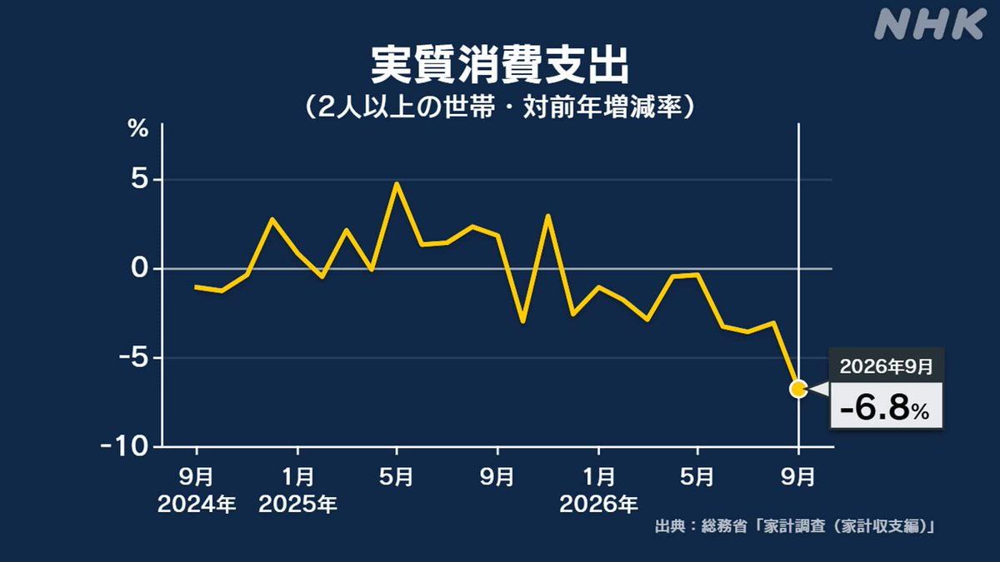
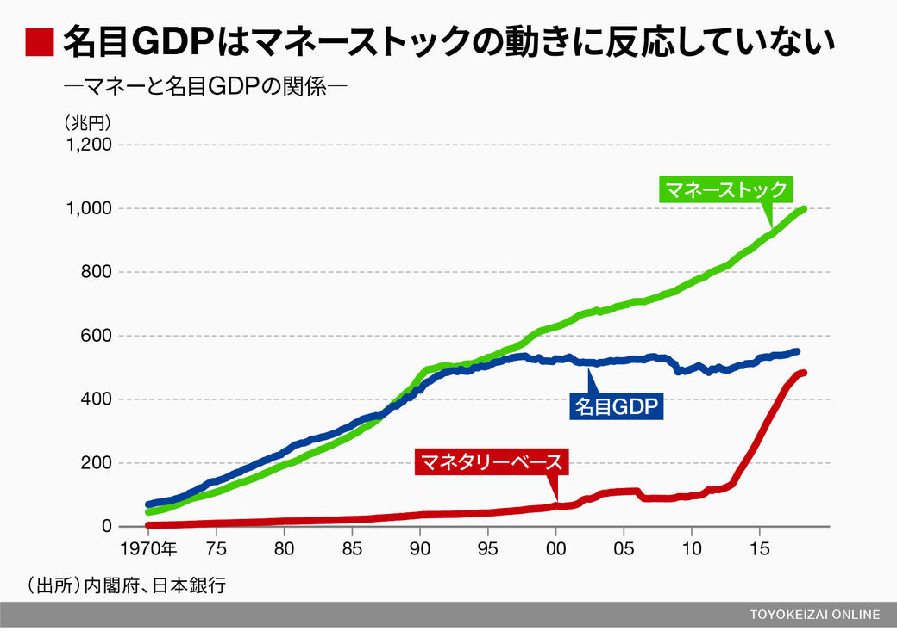
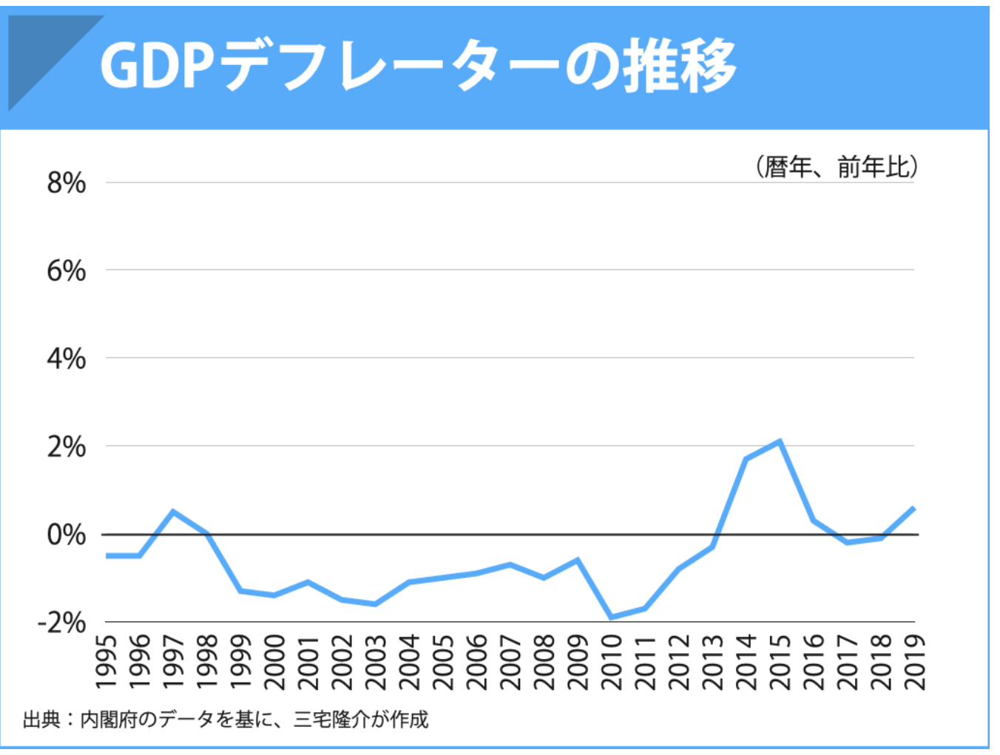

<!-- 元々3回分を1回にまとめないと！！！ -->
# アドバンスセミナーIIB 経済シリーズ 7<!-- omit in toc -->
経済最終回

### 元々あと3回やってた...
本の内容は前回までで終わり。
この後3回やっていたのですが、最新情報を含めて1回にまとめられるかな...

多少端折ってしまうことをご容赦ください。

### 衝撃的なニュース
 [9月の実質消費支出6.8%減　コロナ禍以来の減少幅、インフレと天候不順](https://www.nikkei.com/article/DGXZQOUA0911M0Z01C26A1000000/)

- 2020年9月：10.2%減
- 2026年9月：6.8%減

###

みんなの消費が減り続け景気が悪くなる一方です。
どうすれば、景気が良くなるのでしょうか。

### 今日の流れ
1. お金の歴史と、信用創造というマネーストックのお金が増える仕組みを学ぶ
2. マネタリーベースを増やしても、マネーストックは増えなかった
3. 景気を良くするためにGDPを増やすには？(消費を増やす or 政府支出を増やす)
4. 国の借金は増やしていいのか？悪いのか？
5. 緊縮財政・反緊縮財政、どっちを取るべきか？

## 信用創造
### 銀行とお金
銀行って、金庫にお金がたくさん詰まっていると思いませんか？

本当でしょうか？

### お金について
物々交換が行われていましたが、
直接交換すると大変なので、
お金が生まれます。

最初は貝殻をお金として利用していたようです。

そのため、
> 財、貯、買、貸、貨、販、資、購

など、お金に関する感じには「貝」が使われているという説があります。

### 金本位制
その後、1816年に金本位制と呼ばれる制度が生まれます
> 金を通貨の価値基準とする制度で、
> 各国の中央銀行が発行する紙幣と同額の金を保有し、
> いつでも相互に交換することを保証するものです

日本では1897年に採用され、0.75g=1円と定められます。

### 金本位制の中断・復帰・そして離脱(さらっと)
#### 中断
第一次世界大戦により、金本位制は中断することとなります。

戦争によって増大した対外支払のために金貨の政府への集中が必要となり、
金の輸出を禁止、通貨の金兌換を停止せざるをえなくなったからと言われています。

#### 復帰・そして離脱
**1919年**にアメリカ合衆国が金本位制に復帰したのを皮切りに、各国も次々と復帰したが、**1929年**の世界大恐慌により再び機能しなくなり、**1931年9月**のイギリスを契機として**1937年6月**のフランスを最後に

**すべての国が金本位制を離脱**した。

### 金とドル(さらっと)
第二次世界大戦後、米ドル金為替本位制
> 米ドル金為替本位制（金・ドル本位制／ブレトンウッズ体制）とは、1944年に取り決められた国際通貨制度です。**米ドルと金を固定**し（金1オンス＝35米ドル）、その他の各国通貨は米ドルと固定相場を結ぶ仕組みでした。
 
を中心としたIMFによる体制、所謂「ブレトン・ウッズ体制」が創設された。

**間接的に金と結びつく形での金本位制** となったのである。

1971年8月15日のいわゆる**ニクソン・ショック**以降は、金と米ドルの兌換が停止される。

1976年1月にキングストンで開催されたIMF暫定委員会では、変動相場制と米ドルの金本位制廃止が確認され、1978年4月に協定発効に伴って先進国の通貨における**金本位制は完全に終焉**した。

### そして管理通貨制度へ
管理通貨制度とは、
> 中央銀行や財務省などの通貨当局が、
金準備に拘束されずに通貨の発行量を政策的に管理する制度

です。

### 金という裏付けが全くない貨幣
あなたたちが現在利用しているお金は
「金」と交換できるという裏付けは全くなく、

**その国の政治や経済状況によって貨幣の価値が決まる状態**となっています。

<!--
### 預金準備制度
> 準備預金制度とは、対象となる金融機関に対して、「受け入れている預金 などの一定比率 (これを準備率という) 以上の金額を日本銀行に預け入れること」を義務付ける制度です。(日本銀行)

[準備預金制度とは何ですか？　超過準備とは何ですか？](https://www.boj.or.jp/announcements/education/oshiete/seisaku/b33.htm/)

- 銀行口座に預けたお金はいつでも現金に払い戻しができる。
- つまり、あなたが、お金を銀行に貸している状態です。

その一定比率は日本銀行に預けなくてはいけない、ということですね。

んじゃ、残りは?

### あまらせとくのもったいないよね
だから、誰かに貸しちゃうんです。

 ... すると何がおきてる?

### 例1
1. A さんが 100 円を X 銀行に預けます。
2. 預金準備率を 10%だとすると、X 銀行は 10 円を日本銀行に預けます。
3. X 銀行には 90 円残ります。
4. X 銀行は B さんに 90 円貸します。B さんは C さんにお金を支払うと、C さんが Y 銀行に預金しました。

この時、X 銀行と Y 銀行の中にある現金の総額は 100 円ですが、通帳残 高の総額は 190 円になってないですか?

お金が生まれてしまっていますね。これを続けると、お金は膨れ上がるんです。
100 億円の現金があれば 1000 億円の通帳算高を生み出したことになります。これを**信用創造**といいます。

### 

### この話では
預かったお金をスタートラインに話をしていますが、それですら実際は異なり....

えーーーー??????
-->

### あなたが銀行でお金を借りると？
1. Aさんが X 銀行に 10万円借りたいといった
2. X銀行は、資金の中から10万円を取り出して渡す

ではなくて、

1. A さんが X 銀行に 10 万円借りたいといった
2. X 銀行は A さんに口座をつくらせ、そこに 10 万と数字を書いた (入力した)

こんなにシンプルです。(信じられないけど)

銀行は返済能力のある借り手さえいれば、資金の制約を受けずにいくらでも貸し出しを行うことができます。

<!-- ただし、先ほど言ったように準備預金は法令で義務付けられています。(実際は 0.05-1.2%)

- [準備預金制度における準備率　公表データ](https://www.boj.or.jp/statistics/boj/other/reservereq/junbi.htm)

-->
(「資金の制約」を受けずに、と書きましたが実際は0.05-1.2%を日銀に預ける必要があります。)

### つまり
- 銀行はみんなが預けたお金を他の人に貸して運用している

という見解は間違えということになります。

であり、この時
- 誰かがお金を借りたことでマネーストックが増えた

となります。

#### 自民党の西田議員が日本銀行総裁に確認している動画
<!--
- [西田昌司 お金の正体＝信用創造 20190404](https://www.youtube.com/watch?v=bk6qhR_AWXg)
  -->
- [西田昌司　参議院決算委員会質問（2019.4.4） お金の正体 22:03-24:15](https://youtube.com/watch?v=FcT-KqWqOdo&t=1323)

<!--
- [【参議院】信用創造【財政金融委員会】](https://www.youtube.com/watch?v=_6O52UDE9tY)
-->

### 信用創造まとめ
> 信用創造とは銀行が融資（貸し出し）を行うことで、社会全体の預金通貨（おカネ）を新しく生み出す仕組みのことです。

**誰かが借りるとマネーストックが増える** という仕組みになっています。

<!--
### 現在経済が悪くなっている原因
コロナで経済が悪くなっている？

コロナになる前から経済状況は悪くなっている。

### 実質賃金の推移

### 日本の状況
物価の影響を加味した実質賃金は、この30年ほど下がっていて、他の国は安定して増えている。

**ジャパンアズナンバーワン**(エズラ・ヴォーゲル 1979)と言われた日本が、なぜこうなってしまったのだろうか？

### 原因
いろいろなことが言われています。
- 人口減少(少子高齢化)
- 古い産業構造
- IT化の遅れ
- 消費税増税

調べればまだまだ出てくるでしょう

### 政治家は何をしたの？
色々トライしましたが、今のところ改善の見込みが立っていません。

異次元の金融緩和をしてマネタリーベース(銀行同士が扱えるお金)は確かに増えました。でも、民間(マネーストック)にはお金が回ってこない。

企業が最高益を上げても、内部留保で積まれているだけです。

- [上場企業の24年3月期、3年連続最高益　車と電力がけん引](https://www.nikkei.com/article/DGXZQOUC2078U0Q4A520C2000000/)

- [企業の内部留保、６００兆円　１２年連続で過去最高―投資や人件費、活用に課題・２３年度末](https://www.jiji.com/jc/article?k=2024090200824&g=eco)
- [昨年度の法人企業統計、経常利益は８・８％増と５年連続増…内部留保は１４年連続で過去最大更新](https://www.yomiuri.co.jp/economy/20260901-GYT1T00087/)
-->

# マネタリーベース・マネーストック
### 名目GDP・マネタリーベース・マネーストック

### なぜ？
通常なら
- 銀行はお金を貸して儲けようと思う
- 企業は投資して儲けようと思う

今起きてることは
> 借りて投資しても儲ける見込みがないから借りない

なぜそう思うかというと
> みんなお金を使うのをやめているから

そのため、マネーストックは上がらない

# 景気を良くするためには？GDPを増やすには？

### GDPってなんだっけ？
> GDP=民間消費+民間投資+政府支出+純輸出

これが経済成長率の指標として利用されている。この 4 つのどれかが上がれば、GDP はあがるのに、名目 GDP はこの 2,30 年全然上がってい ない。
どうすれば成長するんだろう?

この 4 つの項目について検討してみるよ。

簡素化のため、純輸出は割愛します。

### 1.民間消費(GDPの約6割)
例えばコロナで特定給付金として 10 万円もらったら経済効果は 3.5 兆円程度、 GDP を 0.7%押しあげたんだ。

政府がお金をみんなに配れば、そりゃ消費活動するので伸びるよね。

逆に、消費税の税率をあげれば、実質利用できるお金が減ってしまうので、消費しなくなるよね。

### 消費税10%の意味
毎月 10 万円稼いでる人が全部消費にあてていたとすると、 1 年間経っ た時に、仮に消費税がゼロだとすると、ざっくり10 万円 (一ヶ月分の収入) が手元に残っている計算になるよ。

それだけ残ってたら、好きなもの買って消費伸びるよね。

### 消費税の目的
後世にツケを残さないために**社会保障費**をみんなで負担しましょう、という触れ込みでした。

消費税法第一条 2
> 消費税の収入については、地方交付税法（昭和二十五年法律第二百十一号）に定めるところによるほか、毎年度、制度として確立された年金、医療及び介護の**社会保障給付**並びに**少子化に対処するため**の施策に要する経費に充てるものとする。

### 本当に?
<!--

-->

### 本当に?
<!--

-->

### 2010年までは消費税があがる一方、所得税や法人税を減らしてきた。

<!--
### ちょっと古いけど...1990,2018年度比較

-->

### そもそも...
税収って、強制的に消費税10%にする強制徴収をおいておけば、

1. 景気が良くなれば
2. みんなの収入(個人・企業含む)が増えて
3. 税収増えるはずですよね。

逆に
1. 景気が悪くなれば
2. みんなの収入(個人・企業含む)が減って
3. 税収減るはずですよね。

6年連続で税収は過去最高を更新しています。
- [昨年度税収８４兆２２２６億円　６年連続で過去最高―財務省](https://www.jiji.com/jc/article?k=2026070301045&g=eco)

### 物価が上がると
ちなみに、物価上がると、消費税上がるの気づいてるかな？

例えば
- 1000円の消費税って100円
- 物価が1.5倍になったら消費税150円

**物価と連動して自動的に税額が上がる**システムとなっています。

### 民間消費まとめ
今日頭でも言ったように、民間消費が伸びていない(落ち込む)ので、民間消費がGDPを押し上げる要因にはなっていないことがわかる。

- 賃金上昇
- 給付金
- 減税

等をしないと、消費は伸びない。これらは政策が大きな影響を与えます。

### 2.民間投資(GDPの約2割)
人の消費が多くなれば、「これなら儲けられるかも」と投資する人も増えるよね。

これは、民間消費と連動している。

逆に、人の消費が減れば、投資しても儲けられない、と考え、投資額も減っていく。

### 例えば
- タピオカブームの時、タピオカの店が増えた
- 鬼滅が流行れば、乗っかったキャンペーンすごく増えた

### 3. 政府支出
コロナの特定給付金の 10 万は、政府が国債を発行して借金して、政府支出が伸びたことを意味します。

政府が公共投資や給付金や公務員を増やすなど支出を増やすことは政治の決定において可能ということになります。

### 4. 純輸出(さらっと)
海外から人が来て、お金を使ってくれれば純輸出はあがる。
日本のインバウンド（訪日外国人旅行）消費額の対GDP比は、直近のデータで約1.3%前後

<!--
- [インバウンド需要の拡大と地域差](https://www5.cao.go.jp/j-j/cr/cr18/chr18_02-01.html)
- -->
- [訪日外国人旅行者数・出国日本人数](https://www.mlit.go.jp/kankocho/tokei_hakusyo/shutsunyukokushasu.html)

一方、海外のデジタルサービスを利用することにより、デジタル赤字が増えています。

- [デジタル赤字とは？——日本経済が直面する「デジタル敗戦」と政策の課題](https://news.yahoo.co.jp/expert/articles/e340244e9c45b634d5a5c0a403579c3ce7d34955)

### 景気を良くする・GDP を伸ばす方法まとめ
> GDP=民間消費+民間投資+政府支出+純輸出

4 つの項目について伸ばす方法をまとめると
- 消費税等を減らしたり、
- 給付金を配ったり、
- 政府が支出を増やす
  
ことが有意義に見える。(賃金上昇は企業が最終的に決めるため)

> GDP=国内総生産=国内総支出

つまり、これらの方法を取れば、君たちの所得も上がるかも！

# 国の借金
### でも...
減税すれば歳入が減るし、給付金配ったり、政府が支出を増やすと歳出が増えて、
**国債**で賄わなくてはいけない。

- [「国の借金」１３４２兆１７２０億円、過去最大を更新…日本のＧＤＰの２・３倍に](https://www.yomiuri.co.jp/economy/20260210-GYT1T00372/)

> 国民１人当たりの借金額は、単純計算で約１０９０万円。国の借金総額は今年３月末にはさらに膨らみ、１４７３兆円に達すると見込まれている。
<!--

[「国の借金」1255兆円　国民1人当たり1000万円超 2022/08/11](https://news.tv-asahi.co.jp/news_economy/articles/000264752.html)
-->

### 破綻するの？
自分の家計と政府の懐事情を考えると、政府の借金が膨大になりすぎて、破綻するんじゃないの？と思うよね？

だって、借金はいつか返さなきゃいけないから、後世の子どもたちにツケを回しちゃいけないよね、とか考えちゃうよね？

### 民間と政府が異なるところ
皆さんが借金したら、返さなくてはいけません。返せなくなった場合には、自己破産手続きをとることになります。

また、勝手にお金を作ることは違法です(捕まります)。

でも、「自国通貨発行権」という言葉があります。

国は自国通貨、つまり「円」を発行できるわけです。

### ギリシャは破綻...
ギリシャでは2009年に破綻の可能性が発覚しました。

ユーロ建で借金をしていました。
ギリシャはユーロを発行できません。ので、返済できなくなると破綻するので、EU各国が支援するということになりました。

日本も第二次世界大戦時には英ポンド・米ドル・仏フラン建による国債を発行して戦時資金を賄い、これは 1980 年代まで返済をしていました。(みんなにとっては昔の話だけど、自分にとっては高校生の頃のことだから、わりと知られてないびっくりする話でした)

### 「円」を発行できるなら？
ギリシャと異なり、日本は「円」を発行できます。

ん？

ってことは、
> **借金があっても、円を発行すれば返せるんじゃない？**

### ここが現在の議論となっているところ
現在、この「打ち出の小槌」みたいな考え方の賛否が非常に問われています。

### 財務省も...
日本国債の格付けを海外の会社が引き下げた時にこんな意見書を出しました。

> 日・米など先進国の自国通貨建国債のデフォルトは考えられない。デ フォルトとして如何なる事態を想定しているのか。
[(外国格付け会社宛意見書要旨)](https://www.mof.go.jp/about_mof/other/other/rating/p140430.htm)

「デフォルト」とは債務不履行、つまり、もうお金返せませーーん、という破綻を意味します。

### 破綻する人の言い分
自国通貨建だとしても借金を増やすと円の価値が暴落してしまい
- 海外からの信用がなくなる
- ハイパーインフレが起こる

という主張をしています。

> ハイパーインフレとは**インフレーション率が毎月50％を超えること**で、一年後には物価が129.75倍に上昇することになります。

### ちなみに...
異次元の金融緩和にて、マネタリーベースを増やし続けたことは、事実 ここ 10 年近く行ってきたことです。

- 海外からの信用はなくなったでしょうか?
- ハイパーインフレが起きたでしょうか?

### 1. 国債の金利は?

### 2. ハイパーインフレ?
<!--

価格が暴騰する状態になっていますか？
目指した2%に届いてすらいません。
(現在はコストプッシュインフレで物価上がってます)
-->

- [日本のインフレ率の推移](https://ecodb.net/country/JP/imf_inflation.html)

### 破綻しないという人の意見
いくらでもお金を作ってよい、といっているわけではなく、
- 政府の借金額の大きさは破綻と関係ない
- インフレ率が高騰しない限り、お金を刷って良い

となります。

「打ち出の小槌」的な、「お金刷れば税金なんか取る必要ないじゃん」という主張とは異なります。

<!--
### MMT
この破綻しないといっている理論を MMT(現代貨幣理論) といい、 自国通貨を発行できる政府は、インフレにならない限り、

> 大量の国債発行をある程度許容する

との主張にまとまります。
-->

### そして
限度を超えない限り国債発行をして
- インフラ整備の拡大
- 社会保障の充実
- 雇用の増加

を行えるとしています。

# 緊縮・反緊縮(積極財政)

### これから日本はどうするべきか？
- 緊縮財政
- 反緊縮財政(積極財政)

の二つの考え方があります。

### 二つの違い
#### 緊縮財政
プライマリーバランス黒字化...つまり、政府の歳入と歳出 を同じにさせ、これ以上政府の借金を増やさない様にしよう という立場
#### 反緊縮財政
インフレ率に注視しながら、積極的に政府がお金を使っていこうという立場

これらは、財政に対する考え方の違いです。

### 現在は緊縮財政派が多い?
**財政再建・プライマリーバランス黒字化**という言葉を使う人は緊縮財政派です。

コロナにおいても、支援は対してせずに、精神論で乗り越えようとします。

反緊縮財政の人は、お金を使ってみんなの生活を保障しながら、コロナを乗り切ろうとします。

現在、減税の議論が行われていますが、これに対して「財源は？」と聞く人は緊縮財政派ということになります。

### コロナで各国はどう動いた？

### コロナ後景気

[コロナ後の日本経済はどう変わるのか？](https://toyokeizai.net/articles/-/577643)

### 現在
これまでプライマリーバランスの黒字化を目標としてきましたが、
2025年10月に「責任ある積極財政」と、方針を変えてきました。

「政府債務残高の対GDP比」を着実に低下させることに目標を変えてきています。

### さて
あなたは
- 緊縮財政
- 反緊縮財政

どちらが良いと思いますか？

### いずれにせよ
みんなが、適切な経済行為を行い、それによって豊かになっていけるような世の中になればよいのだけれど、今の社会何かがおかしいので、どんなに頑張っても豊かになれない仕組みになってしまっていることを憂いています。

貧困が拡大し、多くの人にとって生活するのがやっとになってしまえば、 日本の持つ様々な供給力も減ってしまい、本当に経済が回らなくなってしまいます。

どんなに一生懸命に一人一人が働いていても、そんな仕組みの中に生きているのです。
少しでも興味を持ってどうあるべきか考えて欲しいと思います。

### 2024資料
[https://sammyppr.github.io](https://sammyppr.github.io)

から、2024の3回分の資料みれるようにしてみました。
端折ったところもあるので、興味ある人は情報アップデートされていませんが、見てみてください。

### 課題
あなたは緊縮財政・反緊縮財政、どちらの立場をとりますか? 理由とともに400 字程度でまとめよ。

